# The life of a request

What a `RemediationRequest` goes through, what you see at each step, what moves it on and what you can do. This summarises [design 6](design/6-reconciliation.md#6-reconciliation); every condition reason is explained in [troubleshooting](troubleshooting.md).

The steps after `Merged` are built: the merge receipt, the wait for delivery, the executor's own checks after it, and `Cleared`, which the executor judges from the verifier's `VerificationReport`, so a request can end `Succeeded`. They run only when the executor runs with `--verify-outcomes` (chart value `executor.verification.enabled`), which is off by default until a lab run with a release candidate decides it. With it on and no verifier deployed, no report is written and every merge ends `Inconclusive` (`StaleReport`) or `Failed`. Off, a merged request stays `Merged` and `RolledOut` reports its rollout, except a plan merged after it was known stale, which ends `Inconclusive` (`StalePlanMerged`) once its rollout check is over.

```mermaid
stateDiagram-v2
    [*] --> Pending
    Pending --> Pending: queued by a limit, KEDA has not reported yet, or Flux is reconciling
    Pending --> PolicyChecked: policy allows, source found
    Pending --> Denied: policy refuses
    Pending --> NeedsIntervention: source unclear or ScaledObject not ready
    Pending --> Superseded: another request of the Incident was merged
    Pending --> Superseded: the pull request it waited behind was closed without a merge
    Pending --> Superseded: the request it waited behind succeeded
    PolicyChecked --> PRCreated: branch, commit, pull request
    PRCreated --> AwaitingApproval: review required
    AwaitingApproval --> Merged: a person merges it
    PolicyChecked --> Merged: an existing merged pull request is adopted
    PolicyChecked --> Merged: a replacement whose handoff was aborted at a refusal sees its commit merged within 24 hours (#786)
    PRCreated --> Merged: merged before the first review step
    PolicyChecked --> Expired: no pull request in 30 minutes
    PolicyChecked --> Superseded: a plan input changed
    PRCreated --> Superseded: a plan input changed
    AwaitingApproval --> Superseded: a plan input changed
    AwaitingApproval --> Superseded: its pull request merged with its replacement's commit, once the replacement holds the receipt (MergedForReplacement, #786)
    NeedsIntervention --> Superseded: the same, after a stop (MergedForReplacement, #786)
    PRCreated --> Superseded: a replacement that took the pull request over, merged with its predecessor's commit put back, once the predecessor holds the receipt (MergedForPredecessor, #786)
    AwaitingApproval --> Superseded: the same (MergedForPredecessor, #786)
    NeedsIntervention --> Superseded: the same, after a stop (MergedForPredecessor, #786)
    Pending --> Cancelled: spec.cancel (CancelRequested)
    PolicyChecked --> Cancelled: spec.cancel (CancelRequested)
    PRCreated --> Cancelled: spec.cancel, pull request closed (CancelRequested)
    AwaitingApproval --> Cancelled: spec.cancel, pull request closed (CancelRequested)
    PolicyChecked --> Cancelled: a replacement's handoff did not happen (HandoffRefused, HandoffAborted, HintsTurnedOff)
    PolicyChecked --> Cancelled: its Incident was folded or is gone before the pull request (IncidentFolded, IncidentGone)
    Cancelled --> Merged: its own pull request of a lost open found merged after the cancel (IncidentFolded, IncidentGone)
    Cancelled --> NeedsIntervention: that pull request merged with another change, or not checkable (MergedWithForeignChange, MergeNotCheckable)
    PolicyChecked --> NeedsIntervention: cannot continue alone
    PRCreated --> NeedsIntervention: cannot continue alone
    AwaitingApproval --> NeedsIntervention: pull request closed, head moved or not found
    NeedsIntervention --> Merged: a stopped holder whose own pull request is found merged later (#771, #808)
    NeedsIntervention --> Merged: a replacement whose watch after a refused recovery ended sees its commit merged later (#786)
    NeedsIntervention --> PRCreated: the same, while the merge commit or the check at the merge is awaited (#786)
    NeedsIntervention --> Cancelled: that pull request merged without its commit (HandoffAborted, #786)
    Cancelled --> Merged: a replacement that ended before its takeover sees its commit merged later (#786)
    Cancelled --> PRCreated: the same, while the merge commit or the check at the merge is awaited (#786)
    Expired --> Merged: its own pull request of a lost open found merged by the cleanup after the deadline (#771), a stopped holder's found merged later (#808), or a replacement that ended before its takeover sees its commit merged later (#786)
    Expired --> PRCreated: that replacement, while the merge commit or the check at the merge is awaited (#786)
    Superseded --> Merged: a stale plan whose close the host refused, merged by a person (#199)
    Merged --> Inconclusive: no merge receipt (NoMergeReceipt)
    Merged --> Inconclusive: a stale plan merged, once its rollout check is over, --verify-outcomes off (StalePlanMerged)
    Merged --> WaitingForDelivery: next reconcile, with --verify-outcomes
    WaitingForDelivery --> Verifying: Flux applied the merge commit
    WaitingForDelivery --> Failed: Flux failed on the merge commit (DeliveryFailed)
    WaitingForDelivery --> Inconclusive: not delivered within the hour, the target is gone, or --verify-outcomes off
    Verifying --> Failed: an OOM kill in the verifier's report (OOMKilled), or at the timeout rollout stuck, ScaledObject not ready or restarts (RolloutStuck, KedaNotReady, Restarted)
    Verifying --> Inconclusive: value changed, template replaced, target gone or unreadable, a ScaledObject after stableFor, no evidence at the timeout, or --verify-outcomes off
    Verifying --> Inconclusive: a quiet window for a stale plan merged (StalePlanMerged)
    Verifying --> Succeeded: a quiet window, Cleared True
    Denied --> [*]
    Superseded --> [*]
    Expired --> [*]
    NeedsIntervention --> [*]
    Merged --> [*]
    Failed --> [*]
    Inconclusive --> [*]
    Cancelled --> [*]
```



## What each phase means and what you do

| Phase | What happened | What moves it on | You can |
| --- | --- | --- | --- |
| `Pending` | New, or held back (condition `Queued`: the concurrency limit, the circuit breaker, or another request that holds the lock on the same target until its pull request is known merged (with `--verify-outcomes` on, until the merged request ends) or closed, also after it stopped) | The policy check, rechecked every 30 seconds while queued. While Flux is still reconciling the Kustomization (`PolicyAllowed=Unknown`, reason `KustomizationReconciling`) it waits up to 10 minutes | Wait, or read the reason in [troubleshooting](troubleshooting.md#limits) |
| `PolicyChecked` | Policy allowed it (`PolicyAllowed=True`, reason `WithinApprovedBounds`); the plan digest is fixed | The pull request step | Nothing. It expires after 30 minutes without a pull request |
| `PRCreated` | The branch, commit and pull request exist | The executor records the review state | Open the pull request |
| `AwaitingApproval` | `Approved=False`, reason `WaitingForReview`. When the Incident's count has not changed for an hour while it waits, condition `IncidentStopped` (reason `IncidentCountUnchanged`) and at most one Event `IncidentStopped` say that the symptom may have stopped by itself; the phase stays and the pull request stays open, and the condition goes when the count rises again or the Incident is gone. A stopped or lagging analyzer looks quiet too, so check the analyzer before you close a pull request on this signal | A person merges the pull request, seen within about a minute (`--pull-request-poll-interval`) | [Approve](how-to/review-and-approve.md) or [reject](how-to/reject-a-proposal.md) |
| `Merged` | The pull request was merged; `status.pullRequest.mergeCommitSHA` records the merge commit that delivery will be checked against (that commit or a later one of the target branch that holds it), and `status.mergeReceipt`, written in the same status write and never changed after, binds it to the repository, target branch, pull request number and head ([ADR-0030](adr/0030-merge-receipt-and-verification-outcomes.md)). With `--verify-outcomes` the next reconcile moves it to `WaitingForDelivery`; off (the default) it stays here and `RolledOut` reports whether its pods rolled out. A request merged before receipts existed stays here, gets `Verified=Unknown`, reason `MergedBeforeVerification`, once, and `RolledOut` reports whether its pods rolled out | The next reconcile, with `--verify-outcomes` | Nothing |
| `WaitingForDelivery` | Merged; the executor waits for the Flux Kustomization that applies the target to report the merge commit, or a later commit of the target branch that holds it, applied. `status.deadline` is one hour after the merge, extended by the time writes were paused. `Delivered=Unknown`, reason `DeliveryPending` | Flux applying it (to `Verifying`), or the end of the hour: the last read decides (`Failed` with `DeliveryFailed` when Flux failed on the merge commit itself, else `Inconclusive`); with `--verify-outcomes` turned off, `Inconclusive` (`VerificationDisabled`) at the next reconcile | Check your GitOps controller ([after the merge](#after-the-merge-did-it-reach-the-pods)) |
| `Verifying` | Delivered (`Delivered=True`); every 30 seconds the executor reads the target again: `Configured` (the live field holds the desired value) and `RolledOut` (the pods run the applied template), and the verifier's report, from which it judges `Cleared` (`Unknown`, `Observing`, while the window runs; its own window is `status.verification`). `status.deadline` is the timeout, 21 minutes after the delivery for a memory fix with the defaults | A quiet window for the effective `stableFor` plus `--node-grace` (11 minutes for a memory fix) on the executor's checks and in a fresh report ends it `Succeeded`; an OOM kill the report records ends it `Failed` (`OOMKilled`) at once; a changed value, template or target ends it `Inconclusive` at once; a ScaledObject ends `Inconclusive` (`ClearingNotChecked`) once ready and configured for `stableFor`; a revert (`spec.reverts`) reads no report and ends `Inconclusive` (`RevertApplied`) once rolled out, configured and available for `stableFor`, never `Succeeded`; at the timeout it ends `Failed` (`RolloutStuck`, `KedaNotReady`, or `Restarted` when the report recorded restarts) and otherwise `Inconclusive` with the reason that held the window closed (`StaleReport`, `PodNotReady`, ...); with `--verify-outcomes` turned off, `Inconclusive` (`VerificationDisabled`) at the next reconcile | `kubectl shadewright explain` shows rolled out, configured and cleared |
| `Failed` | After the merge: Flux failed on the merge commit itself at the end of the delivery window (`DeliveryFailed`), the rollout was still stuck at the timeout (`RolloutStuck`), a ScaledObject target was not ready at the timeout (`KedaNotReady`), the verifier's report recorded an OOM kill of the action's container (`OOMKilled`, at once) or restarts after its window opened (`Restarted`, at the timeout); `Verified=False` says which, and `Cleared=False` for the last two | Nothing, final. The circuit breaker counts it as a failure | Look at the merged change; revert it with a new request or by hand |
| `Denied` | Policy or settings refuse the plan, or a revert's link to the failed request does not hold (`InvalidRevert`) | Nothing, final | [Find the reason](how-to/find-why-refused.md), fix, apply a new request |
| `NeedsIntervention` | The executor cannot continue safely alone: a pull request closed without a merge (`ChangeRequestClosed`), a merge conflict the Git host still reports two minutes after it first did (`ChangeRequestConflict`), a moved head (`HeadMoved`), a render refusal, a ScaledObject that is not ready | Nothing, final | Read the reason, then apply a new request if the change is still wanted |
| `Superseded` | A plan input changed before merge (policy, settings, target, file in Git). If a pull request was open, Shadewright closed it; when the Git host had refused that close and the pull request was then found closed, `PullRequestOpened` says it is not known whether Shadewright's retried close or a person closed it. Or, reason `AnotherRequestMerged`, another request of the same Incident, target and field was merged while this one waited, before it took the target lock or opened a pull request. Or, reason `AnotherRequestClosed`, the pull request of another request for the same target and field was closed without a merge while this one waited, so it opens none for that field. Or, reason `AnotherRequestSucceeded`, with `--verify-outcomes` on, the request it waited behind changed the same field from the same previous value in the same direction, was merged and ended `Succeeded`, so this one's previous value is gone and its fix is not needed (its Incident follows that success) | Nothing, final | Apply a new request; for `AnotherRequestMerged` and `AnotherRequestSucceeded`, nothing: the other request is the fix; for `AnotherRequestClosed`, nothing unless the change is still wanted: a new analysis proposes again if the symptom continues |
| `Expired` | No pull request opened within 30 minutes of the decision | Final, except for its cleanup: a pull request it opened while the write that would record it was lost is closed, or, found merged, recorded as its own merge (`Merged`); a close that keeps failing for 24 hours, and once more after that (not during a pause), ends the cleanup with reason `PullRequestDeadlineCleanupFailed`, and a person closes the pull request | Find why the Git calls failed, apply a new request |
| `Inconclusive` | Merged, and neither success nor failure could be shown; `Verified=Unknown` says why: `NoMergeReceipt` (the Git host reported no full merge commit within five minutes of the executor first seeing the merge), `DeliveryNotObserved`, `DeliveryBlocked`, `DeliverySuspended`, `DeliveryNotChecked`, `TargetGone`, `TargetReplaced`, `ValueChanged`, `RolloutSuperseded`, `TargetNotChecked`, `ClearingNotChecked`, `CheckNotAvailable`, `StalePlanMerged` (a person merged a plan that was stale when the merge was recorded; never `Succeeded`), the no-evidence reasons of the stable window (`StaleReport`, `ReportMismatch`, `PartialRollout`, `NotAvailable`, `PodNotReady`, `EvidenceMissing`, `ScaledToZero`, `ObservationGap`), `RevertApplied` (a revert ran its course; the change it undid had failed, so the Incident stays with a person) or `VerificationDisabled` (see [troubleshooting](troubleshooting.md#after-the-merge)) | Nothing, final. The circuit breaker reads it like `Expired`; the Incident is escalated | Check by hand what the merge put on the target branch and whether it was applied ([troubleshooting](troubleshooting.md#merge-receipt)) |

The API also defines `AutoMergeQueued`, which nothing sets yet (planned). `Cancelled` is final, except that a request cancelled for its Incident whose own pull request is found merged moves on to `Merged`. The same holds for every stopped request that still holds the lock on its target (`NeedsIntervention`, `Expired`, `Cancelled`, a `Superseded` stale plan): a merge of its own pull request found later is recorded first, as a stale plan's merge, and the request moves on to `Merged` (#771, #808). A stale plan's cleanup with no pull request recorded that the Git host refused (`NeedsIntervention`, `PlanFresh` `False` with `GitForbidden` or `GitRejected`) also tries the close of its own pull request again at each of these reads, through the installation the cleanup used, a new one included, and the lock goes once the pull request is closed (#808). An exception is the cleanup right after the deadline (`Expired` with `PullRequestDeadline`): a pull request it opened while the write that would record it was lost, found merged then, is recorded as the request's own merge, also when a read of it failed first (fifth decision of 2026-11-18 on #771); while the check of the plan at that merge does not answer, the request stays `Expired` with the pull request recorded, and never goes back to `PRCreated`. A pause holds these reads: the first reconcile after it makes them, before anything else (sixth decision of 2026-11-18 on #771). Such a request ends `Inconclusive` with `StalePlanMerged` at best, so the circuit breaker never counts it as a success; a `Failed` verification still counts as a failure, and a merge recorded without a receipt (`MergedWithForeignChange`, `MergeContentUnreadable`, `MergeNotCheckable`) counts as no outcome. A request is cancelled when a person set `spec.cancel` before the merge (reason `CancelRequested`; the executor closed the pull request, if one was open, and left the branch), or a replacement's handoff did not happen, or the request's Incident was folded into its cause's Incident or is gone before the pull request opened (`IncidentFolded`, `IncidentGone`; no pull request was opened, and the target stays locked until the next read of the branch finds no open pull request that may deliver the change; a pull request of its own that this read finds open, from an earlier open whose answer was lost, is recorded and closed first, one found closed is recorded with the reason moved to `Approved`, and one found merged moves the request on to `Merged` and then `Inconclusive` with `StalePlanMerged`, or to `NeedsIntervention` with `MergedWithForeignChange` when another change was merged with it, with the reason kept on `PlanFresh`; that is the exception above) ([troubleshooting](troubleshooting.md#how-to-read-the-result)). `Succeeded` is set after `Verifying` (`Cleared=True` and `Verified=True`, reason `NoRecurrence`; `Cleared` has `ResolvedBeforeRollout` instead when the Incident's count did not move from the merge to the rollout); it is final, and the circuit breaker clears older outcomes by it. Auto-merge is not built: even with a policy that has `approval: Optional` and a request with `approvalRequired: false`, a person decides.

Conditions give the reasons: `PolicyAllowed` (the policy check), `PullRequestOpened`, `Approved`, `PlanFresh` (the plan is still current, checked every five minutes before merge), `Delivered`, `Configured` and `RolledOut` (after the merge) and `Verified` (after the merge: `False` for `Failed`, `Unknown` for `Inconclusive` and for `MergedBeforeVerification`). A request that stopped and keeps the lock on its target because another pull request is open on its branch has `TargetHeld`, which names that pull request. A pause adds `WritesPaused`, see [pause and resume](how-to/pause-and-resume.md). A request waiting for review whose Incident stopped counting has `IncidentStopped` ([troubleshooting](troubleshooting.md#pull-request-step)).

## After the merge: did it reach the pods?

A merge, and even Flux applying it, does not mean the pods run the fix. <span class="sw-status sw-built">built</span> With `--verify-outcomes` off (the default), and for a request merged before receipts existed: for a Deployment or StatefulSet target, once the Flux Kustomization that applies it reports the merge commit (or a later commit of the target branch that holds it) applied, the executor records that time in `status.pullRequest.appliedObservedAt`, reads the target's rollout status and sets `RolledOut`: `True` when every pod runs the new template, `False` with reason `RolloutStuck` and one Event when the rollout has not completed 10 minutes after the revision was applied, naming the StatefulSet pods still on the old revision and the manual step (it names a pod to delete only when it is certain the pod is not Ready). It reports only: deleting or restarting a pod stays your decision. A delivery not seen within an hour of the merge gives `False` with reason `DeliveryNotObserved` and one Event, naming the Kustomization, the merge commit and the branch (the merge receipt's, which after a pull request was moved to a newly configured target branch and merged there is that branch, #771; a later commit of that branch counts, asked of the receipt's repository); another target kind gives `Unknown` with reason `KindNotChecked`. A stuck rollout is read until an hour after its deadline, so one you unblock turns `True`; the check always ends with a verdict, `Unknown` with reason `RolloutSuperseded` when a newer template revision replaced the one applied with the merge, or `RolloutNotDetermined` when the target is gone or cannot be read. See [troubleshooting](troubleshooting.md#rollout-after-the-merge).

## What approving means

Shadewright never approves its own pull request and does not check reviews itself. Approval is your normal review on GitHub, enforced by your branch rules (required reviews and checks, `CODEOWNERS`). When a person merges, the executor sees it and ends the request `Merged`. See [design 8.1](design/8-gitops-on-github.md#81-what-approvalrequired-means).

## When the plan changes after the pull request

What happens depends on the cause. Only these cases close the pull request, and Shadewright never reopens one:

- A stale plan (a changed policy, settings, target or source file) ends `Superseded` and the executor closes its pull request.
- A render refusal while the pull request waits (`TargetFileDiverged`, `PatchRefused`, `BranchDiverged`, an unplanned difference in the rendered output, or `RenderNeverFinished` after three renders in a row that the executor did not survive) closes it and ends `NeedsIntervention`. In a handoff the same refusals end the replacement `Cancelled` with `HandoffAborted`, with the render's reason in the message, and the pull request stays as it was.
- A branch that does not hold exactly the planned change when the pull request is opened or found before it was recorded (`BranchDiverged`, for example a push to the branch during the open) closes it and ends `NeedsIntervention`.
- A push to a recorded pull request that leaves more than the planned change on the branch (`BranchDiverged`) ends `NeedsIntervention` with one comment on the pull request that hands it to a person; it stays open. Merged by then, the request ends `MergedWithForeignChange`.

These stop the automation but leave the pull request open, so a person closes it (or merges it knowingly): `HeadMoved` (the head moved to the same planned change), `ChangeRequestConflict` (the Git host reports a merge conflict and the plan is still fresh), `ChangeRequestGone`, `ForeignChangeRequest`. The way back to the change is a new request. One case leaves the pull request open and still records it: after the target branch of the plan's repository changed in the settings (`TargetBranchChanged`), the request keeps the target lock while its pull request is open, and a person who moves it to the new branch and merges it there, or merges it into the old one, gets it recorded `Merged` and then `Inconclusive` with `StalePlanMerged`, even long after the stop. A merge into the new branch that brings it more than the planned change, compared as a whole with what the branch held before the merge, ends `MergedWithForeignChange` instead, and one whose content cannot be read for five minutes ends `MergeContentUnreadable` (#771). See [troubleshooting](troubleshooting.md#pull-request-step).

Every stopped request uses the same target-lock settlement, including cancellation, expiry, stale cleanup and handoff recovery. It reads both the recorded and configured target branches and releases the lock only when no pull request from its branch can still merge, except a merge the status records (design 6.6.1). A replacement that ended before it took the pull request over, whatever ended it, reads that pull request first: it records a merge of its commit on itself, keeps the lock while the pull request is open with any head but the predecessor's own, and releases it with its handoff `Aborted` otherwise; the predecessor leaves a merge of its replacement's commit to the replacement and ends `Superseded` with `MergedForReplacement` (#786). A second open pull request keeps the lock even after the recorded one closes; `TargetHeld` names it. A request cancelled for its Incident is checked on both branches after a branch change too. The branch-change stop permits reads only.

A failed Git read records a wait in `status.gitWaits`, one entry per kind with its start (a failure of another read never replaces or moves one that stands), and `GitReadRetry=True` summarizes them: the operations, the reason of the entry that ends first (`GitReadFailed` when nothing ends it, `GitReadFailedBeforeDeadline`, `GitReadFailedBeforeHandoffGrace`, `GitReadFailedBeforeHandoffRecovery`, `GitReadFailedBeforeMergeWait` or `GitReadFailedBeforeContentWait`) and its start in `lastTransitionTime`, then waits the poll interval (or a longer `Retry-After`), never past the bound of the step that made the read. It never uses the controller's default error backoff; a Kubernetes error does, even right after a failed Git read. Successful reads remove the waits and the condition, except the merge waits: the content-read wait, which only a successful content read removes, so a later failure gets a new five-minute window, and the merge commit wait, which ends at its end or with the merge recorded. Kubernetes errors remain separate. A wait never passes a bound the step has: a request in `PolicyChecked` still expires at its deadline, the content and merge commit waits end after five minutes from their own start, but only after one more read made once that end has passed (not under a pause): an answer goes on as after any read, a failure ends the wait, the delivery check ends at its window and grace, a handoff recovery at its grace (`HandoffGrace`), and the watch of a replacement whose handoff was aborted at the first refusal of a read of its recovery 24 hours after that refusal (`HandoffRecovery`, the record of the abort, kept by reconciles whose reads work and by a pause, recorded once and never moved; the write that records it removes the `HandoffGrace` entry of the intent it aborts, so each entry ends at its own end: `NeedsIntervention` with `RecoveryWaitExpired`, #786), and a deletion or a cancel still ends its wait at its grace or its 24 hour bound. The end of a wait is decided from that recorded state by one check at the start of every reconcile, before any read (for the content and merge commit waits, that check lets the reconcile make its last read and ends the wait after it when the read failed or could not be made), so no timeout or early return of a step skips it. A read the Git host refuses for good (403 or 422) before a pull request is recorded stops the request at once, as before, except in the recovery of a handoff, where it aborts the handoff at once: the request it replaces goes on (it stops `BranchDiverged` with one comment only when the branch carries the replacement's commit, and ends `Superseded` like any stale plan when its plan is stale), and the replacement writes nothing to Git and watches the pull request with condition `PullRequestUnreadable` for a merge of its commit until that watch ends, keeping the target lock (#786). The end of the watch is no verdict: the replacement stays `NeedsIntervention` with `RecoveryWaitExpired`, its `status.handoff.from` still `Reserved` (the predecessor's `status.handoff.to` is `Aborted`), and keeps the lock; the look at stopped holders (every 10 minutes) records a merge of its commit with its receipt whenever it comes, and releases the lock once the pull request is closed, the branch or the repository is gone (the host closes a pull request whose branch is deleted, and that close releases it; a repository that left the settings releases it at the first look, as no read of the pull request can start, while a missing `RemediationSettings` object keeps it; when the settings name another target branch, the pull request is read on the branch the plan recorded, so a merge or a close there settles the lock as above; second round of #786), or that merge is recorded.

## Read it yourself

```bash
kubectl -n shadewright-system get remediationrequest
kubectl -n shadewright-system get remediationrequest <name> \
  -o jsonpath='{.status.phase}{"\n"}{range .status.conditions[*]}{.type}={.status} {.reason}: {.message}{"\n"}{end}'
```

!!! note "Not yet run"
    The commands on this page and in the how-to guides were not run against a live cluster for these pages (no kind cluster was available). The `get` and `jsonpath` forms are the ones already used in [troubleshooting](troubleshooting.md) and the [lab runbook](lab-oom-acceptance.md); the short name `rr` and the printed columns (Phase, Policy, Action, Target, PR, Age) come from the API types.
