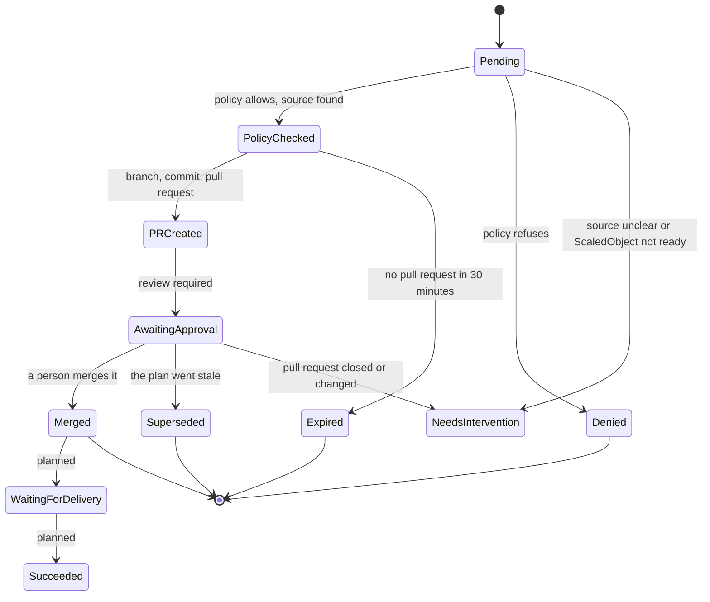

# The life of a request

What a `RemediationRequest` goes through, what you see at each step, what moves it on and what you can do. This summarises [design 6](design.md#6-reconciliation); every condition reason is explained in [troubleshooting](troubleshooting.md).

Only the steps up to `Merged` are built. Delivery tracking and verification are <span class="sw-status sw-planned">planned</span>: after a merge the request stops at `Merged`.



## What each phase means and what you do

| Phase | What happened | What moves it on | You can |
| --- | --- | --- | --- |
| `Pending` | New, or held back (condition `Queued`: another request on the same target, the concurrency limit or the circuit breaker) | The policy check, rechecked every 30 seconds while queued | Wait, or read the reason in [troubleshooting](troubleshooting.md#limits) |
| `PolicyChecked` | Policy allowed it (`PolicyAllowed=True`, reason `WithinApprovedBounds`); the plan digest is fixed | The pull request step | Nothing. It expires after 30 minutes without a pull request |
| `PRCreated` | The branch, commit and pull request exist | The executor records the review state | Open the pull request |
| `AwaitingApproval` | `Approved=False`, reason `WaitingForReview` | A person merges the pull request, seen within about five minutes | [Approve](how-to/review-and-approve.md) or [reject](how-to/reject-a-proposal.md) |
| `Merged` | The pull request was merged. The request stops here today | Nothing (delivery is the GitOps controller's job; verification is planned) | Check your GitOps controller |
| `Denied` | Policy or settings refuse the plan | Nothing, final | [Find the reason](how-to/find-why-refused.md), fix, apply a new request |
| `NeedsIntervention` | The executor cannot continue safely alone, including a pull request closed without a merge (`ChangeRequestClosed`) | Nothing, final | Read the reason, then apply a new request if the change is still wanted |
| `Superseded` | A plan input changed before merge (policy, settings, target, file in Git); the pull request was closed | Nothing, final | Apply a new request |
| `Expired` | No pull request opened within 30 minutes of the decision | Nothing, final | Find why the Git calls failed, apply a new request |

The API also defines `AutoMergeQueued`, `WaitingForDelivery`, `Verifying`, `Succeeded`, `Failed` and `Cancelled`. Nothing sets them yet (planned). Auto-merge is not built: even with a policy that has `approval: Optional` and a request with `approvalRequired: false`, a person decides.

Conditions give the reasons: `PolicyAllowed` (the policy check), `PullRequestOpened`, `Approved` and `PlanFresh` (the plan is still current, checked every five minutes before merge). A pause adds `WritesPaused`, see [pause and resume](how-to/pause-and-resume.md).

## What approving means

Shadewright never approves its own pull request and does not check reviews itself. Approval is your normal review on GitHub, enforced by your branch rules (required reviews and checks, `CODEOWNERS`). When a person merges, the executor sees it and ends the request `Merged`. See [design 8.1](design.md#81-what-approvalrequired-means).

## When the plan changes after the pull request

A new push to the Shadewright branch, a different target file in Git, or an edited policy invalidates the plan. The executor then closes its pull request (`Superseded`, or `NeedsIntervention` for `HeadMoved` and similar) and never reopens it. The way back is a new request.

## Read it yourself

```bash
kubectl -n shadewright-system get remediationrequest
kubectl -n shadewright-system get remediationrequest <name> \
  -o jsonpath='{.status.phase}{"\n"}{range .status.conditions[*]}{.type}={.status} {.reason}: {.message}{"\n"}{end}'
```

!!! note "Not yet run"
    The commands on this page and in the how-to guides were not run against a live cluster for these pages (no kind cluster was available). The `get` and `jsonpath` forms are the ones already used in [troubleshooting](troubleshooting.md) and the [lab runbook](lab-oom-acceptance.md); the short name `rr` and the printed columns (Phase, Action, Target, PR, Age) come from the API types.
