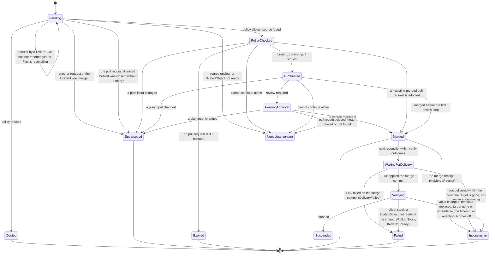

# The life of a request

What a `RemediationRequest` goes through, what you see at each step, what moves it on and what you can do. This summarises [design 6](design/6-reconciliation.md#6-reconciliation); every condition reason is explained in [troubleshooting](troubleshooting.md).

The steps up to `Verifying` are built: the merge receipt, the wait for delivery and the executor's own checks after it. The end `Succeeded` is <span class="sw-status sw-planned">planned</span>: it needs the verifier's evidence that the symptom cleared, so until then a request in `Verifying` ends `Failed` or `Inconclusive` at its timeout. That is why the steps after `Merged` run only when the executor runs with `--verify-outcomes` (chart value `executor.verification.enabled`), which is off by default: with no way to end `Succeeded`, every merge would end `Inconclusive` or `Failed`, and the circuit breaker would not close again once it tripped. Off, a merged request stays `Merged` and `RolledOut` reports its rollout.



## What each phase means and what you do

| Phase | What happened | What moves it on | You can |
| --- | --- | --- | --- |
| `Pending` | New, or held back (condition `Queued`: the concurrency limit, the circuit breaker, or another request that holds the lock on the same target until its pull request is known merged or closed, also after it stopped) | The policy check, rechecked every 30 seconds while queued. While Flux is still reconciling the Kustomization (`PolicyAllowed=Unknown`, reason `KustomizationReconciling`) it waits up to 10 minutes | Wait, or read the reason in [troubleshooting](troubleshooting.md#limits) |
| `PolicyChecked` | Policy allowed it (`PolicyAllowed=True`, reason `WithinApprovedBounds`); the plan digest is fixed | The pull request step | Nothing. It expires after 30 minutes without a pull request |
| `PRCreated` | The branch, commit and pull request exist | The executor records the review state | Open the pull request |
| `AwaitingApproval` | `Approved=False`, reason `WaitingForReview` | A person merges the pull request, seen within about a minute (`--pull-request-poll-interval`) | [Approve](how-to/review-and-approve.md) or [reject](how-to/reject-a-proposal.md) |
| `Merged` | The pull request was merged; `status.pullRequest.mergeCommitSHA` records the merge commit that delivery will be checked against (that commit or a later one of the target branch that holds it), and `status.mergeReceipt`, written in the same status write and never changed after, binds it to the repository, target branch, pull request number and head ([ADR-0030](adr/0030-merge-receipt-and-verification-outcomes.md)). With `--verify-outcomes` the next reconcile moves it to `WaitingForDelivery`; off (the default) it stays here and `RolledOut` reports whether its pods rolled out. A request merged before receipts existed stays here, gets `Verified=Unknown`, reason `MergedBeforeVerification`, once, and `RolledOut` reports whether its pods rolled out | The next reconcile, with `--verify-outcomes` | Nothing |
| `WaitingForDelivery` | Merged; the executor waits for the Flux Kustomization that applies the target to report the merge commit, or a later commit of the target branch that holds it, applied. `status.deadline` is one hour after the merge, extended by the time writes were paused. `Delivered=Unknown`, reason `DeliveryPending` | Flux applying it (to `Verifying`), or the end of the hour: the last read decides (`Failed` with `DeliveryFailed` when Flux failed on the merge commit itself, else `Inconclusive`); with `--verify-outcomes` turned off, `Inconclusive` (`VerificationDisabled`) at the next reconcile | Check your GitOps controller ([after the merge](#after-the-merge-did-it-reach-the-pods)) |
| `Verifying` | Delivered (`Delivered=True`); every 30 seconds the executor reads the target again: `Configured` (the live field holds the desired value) and `RolledOut` (the pods run the applied template). `status.deadline` is the timeout, 21 minutes after the delivery for a memory fix with the defaults | A changed value, template or target ends it `Inconclusive` at once; at the timeout it ends `Failed` (`RolloutStuck`) when the rollout did not complete or `Failed` (`KedaNotReady`) when a ScaledObject is not ready, and otherwise `Inconclusive` (`ClearingNotChecked`) until reading the verifier's evidence is built; with `--verify-outcomes` turned off, `Inconclusive` (`VerificationDisabled`) at the next reconcile | Watch the symptom yourself: `Succeeded` is planned |
| `Failed` | After the merge: Flux failed on the merge commit itself at the end of the delivery window (`DeliveryFailed`), the rollout was still stuck at the timeout (`RolloutStuck`), or a ScaledObject target was not ready at the timeout (`KedaNotReady`); `Verified=False` says which | Nothing, final. The circuit breaker counts it as a failure | Look at the merged change; revert it with a new request or by hand |
| `Denied` | Policy or settings refuse the plan | Nothing, final | [Find the reason](how-to/find-why-refused.md), fix, apply a new request |
| `NeedsIntervention` | The executor cannot continue safely alone: a pull request closed without a merge (`ChangeRequestClosed`), a merge conflict the Git host still reports two minutes after it first did (`ChangeRequestConflict`), a moved head (`HeadMoved`), a render refusal, a ScaledObject that is not ready | Nothing, final | Read the reason, then apply a new request if the change is still wanted |
| `Superseded` | A plan input changed before merge (policy, settings, target, file in Git). If a pull request was open, Shadewright closed it. Or, reason `AnotherRequestMerged`, another request of the same Incident, target and field was merged while this one waited, before it took the target lock or opened a pull request. Or, reason `AnotherRequestClosed`, the pull request of another request for the same target and field was closed without a merge while this one waited, so it opens none for that field | Nothing, final | Apply a new request; for `AnotherRequestMerged`, nothing: the merged request is the fix; for `AnotherRequestClosed`, nothing unless the change is still wanted: a new analysis proposes again if the symptom continues |
| `Expired` | No pull request opened within 30 minutes of the decision | Nothing, final | Find why the Git calls failed, apply a new request |
| `Inconclusive` | Merged, and neither success nor failure could be shown; `Verified=Unknown` says why: `NoMergeReceipt` (the Git host reported no full merge commit within five minutes of the executor first seeing the merge), `DeliveryNotObserved`, `DeliveryBlocked`, `DeliverySuspended`, `DeliveryNotChecked`, `TargetGone`, `TargetReplaced`, `ValueChanged`, `RolloutSuperseded`, `TargetNotChecked`, `ClearingNotChecked` or `VerificationDisabled` (see [troubleshooting](troubleshooting.md#after-the-merge)) | Nothing, final. The circuit breaker reads it like `Expired`; the Incident is escalated | Check by hand what the merge put on the target branch and whether it was applied ([troubleshooting](troubleshooting.md#merge-receipt)) |

The API also defines `AutoMergeQueued`, `Succeeded` and `Cancelled`. Nothing sets them yet (planned). Auto-merge is not built: even with a policy that has `approval: Optional` and a request with `approvalRequired: false`, a person decides.

Conditions give the reasons: `PolicyAllowed` (the policy check), `PullRequestOpened`, `Approved`, `PlanFresh` (the plan is still current, checked every five minutes before merge), `Delivered`, `Configured` and `RolledOut` (after the merge) and `Verified` (after the merge: `False` for `Failed`, `Unknown` for `Inconclusive` and for `MergedBeforeVerification`). A request that stopped and keeps the lock on its target because another pull request is open on its branch has `TargetHeld`, which names that pull request. A pause adds `WritesPaused`, see [pause and resume](how-to/pause-and-resume.md).

## After the merge: did it reach the pods?

A merge, and even Flux applying it, does not mean the pods run the fix. <span class="sw-status sw-built">built</span> With `--verify-outcomes` off (the default), and for a request merged before receipts existed: for a Deployment or StatefulSet target, once the Flux Kustomization that applies it reports the merge commit (or a later commit of the target branch that holds it) applied, the executor records that time in `status.pullRequest.appliedObservedAt`, reads the target's rollout status and sets `RolledOut`: `True` when every pod runs the new template, `False` with reason `RolloutStuck` and one Event when the rollout has not completed 10 minutes after the revision was applied, naming the StatefulSet pods still on the old revision and the manual step (it names a pod to delete only when it is certain the pod is not Ready). It reports only: deleting or restarting a pod stays your decision. A delivery not seen within an hour of the merge gives `False` with reason `DeliveryNotObserved` and one Event, naming the Kustomization and the merge commit; another target kind gives `Unknown` with reason `KindNotChecked`. A stuck rollout is read until an hour after its deadline, so one you unblock turns `True`; the check always ends with a verdict, `Unknown` with reason `RolloutSuperseded` when a newer template revision replaced the one applied with the merge, or `RolloutNotDetermined` when the target is gone or cannot be read. See [troubleshooting](troubleshooting.md#rollout-after-the-merge).

## What approving means

Shadewright never approves its own pull request and does not check reviews itself. Approval is your normal review on GitHub, enforced by your branch rules (required reviews and checks, `CODEOWNERS`). When a person merges, the executor sees it and ends the request `Merged`. See [design 8.1](design/8-gitops-on-github.md#81-what-approvalrequired-means).

## When the plan changes after the pull request

What happens depends on the cause. Only these cases close the pull request, and Shadewright never reopens one:

- A stale plan (a changed policy, settings, target or source file) ends `Superseded` and the executor closes its pull request.
- A render refusal while the pull request waits (`TargetFileDiverged`, `PatchRefused`, `BranchDiverged`, an unplanned difference in the rendered output) closes it and ends `NeedsIntervention`.
- A branch that does not hold exactly the planned change when the pull request is opened or found before it was recorded (`BranchDiverged`, for example a push to the branch during the open) closes it and ends `NeedsIntervention`.
- A push to a recorded pull request that leaves more than the planned change on the branch (`BranchDiverged`) ends `NeedsIntervention` with one comment on the pull request that hands it to a person; it stays open. Merged by then, the request ends `MergedWithForeignChange`.

These stop the automation but leave the pull request open, so a person closes it (or merges it knowingly): `HeadMoved` (the head moved to the same planned change), `ChangeRequestConflict` (the Git host reports a merge conflict and the plan is still fresh), `ChangeRequestGone`, `ForeignChangeRequest`. The way back to the change is a new request. See [troubleshooting](troubleshooting.md#pull-request-step).

## Read it yourself

```bash
kubectl -n shadewright-system get remediationrequest
kubectl -n shadewright-system get remediationrequest <name> \
  -o jsonpath='{.status.phase}{"\n"}{range .status.conditions[*]}{.type}={.status} {.reason}: {.message}{"\n"}{end}'
```

!!! note "Not yet run"
    The commands on this page and in the how-to guides were not run against a live cluster for these pages (no kind cluster was available). The `get` and `jsonpath` forms are the ones already used in [troubleshooting](troubleshooting.md) and the [lab runbook](lab-oom-acceptance.md); the short name `rr` and the printed columns (Phase, Policy, Action, Target, PR, Age) come from the API types.
