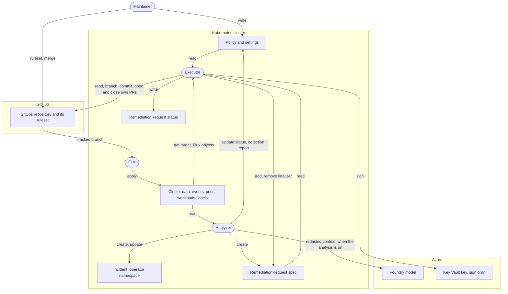

# Threat model

This page says what Shadewright guarantees, against whom, and how each guarantee is enforced and tested, so a reader can tell a promise from a plan. It records the state of `main` on 2026-11-03; it does not decide anything. Decisions are in the [design](design.md) and the [ADRs](adr/index.md), and a change that weakens an invariant still needs an ADR first.

Every guarantee in the [table](#4-guarantees) names the code that enforces it and the tests that show it works and that it refuses. Three words mark how far each one is built:

- **Built:** the running operator does it, and a test on `main` shows it.
- **Built, not wired:** the code and its tests exist, but the running operator does not call it yet. It is a promise about a library, not about the system.
- **Planned:** designed, not built. The row links its issue.

Paths are relative to the repository root. Tests are named by file and test (Go `TestX`, or the Ginkgo `It` text in quotes).

## 1. What is protected

| Asset | Property | Why it matters |
| --- | --- | --- |
| Workloads and configuration in the cluster | Integrity | The point of the project: they change only through a merged commit that Flux applies |
| The protected branch of the GitOps repository (`targetBranch`, `main` in the lab) | Integrity | Flux applies whatever lands there, with Flux's own permissions |
| The GitHub App private key and its installation tokens | Confidentiality | They are the only write access to Git |
| Secrets and personal data in the cluster | Confidentiality | Cluster data goes to a model and, redacted, to analysis records (when a record store is configured) |
| `RemediationPolicy` and `RemediationSettings` | Integrity | They decide what may change, where, and whether a human reviews it; the model endpoints in the settings (`spec.analysis.models`, read when the analyzer runs with `--triage-model`) decide where the analyzer's Entra ID token and the redacted context go, so write access to the settings, the `patch` right the [emergency runbook](emergency.md) hands out for the kill switch included, is security-relevant |
| The status of a `RemediationRequest` | Integrity | It is the decision: phase, resolved source, plan digest, effective approval |

## 2. Trust boundaries

Each box is a party; the subgraphs are the systems they run in. Solid links are built code paths; dashed boxes and links are planned (for the analyzer, the collector and the Incident controller are built and drawn solid; the analysis and the requests it would create are planned). The analyzer and the executor are separate identities: separate ServiceAccounts, roles, leases and Azure identities (G6.1).

| Party | Trusted for | Not trusted for | State |
| --- | --- | --- | --- |
| Analyzer | Nothing that changes anything: it reads, proposes and writes the detection report to the settings status, which nothing reads to decide | Any of its output as authorization; it can only create a request | Binary, RBAC, collector, Incident controller, analysis trigger and platform detection built; analysis loop built in `internal/analysis` and run by the analyzer with `--triage-model`, off by default (#76) |
| Model | Nothing | Anything: its output is untrusted input to the analyzer | Foundry adapter built: replies bounded and checked, malformed output refused (#75); analysis loop built in `internal/analysis`, tested with a fake model, run by the analyzer with `--triage-model`, off by default; a reply from another model than the configured one is refused (#76). No evaluation gate yet (#78): a real-model run is an evaluation run in the lab |
| Verifier | Nothing that decides: it samples the pods of a rollout and writes its own `VerificationReport`; no model, no Git identity, no Secrets, never request status | Any of its output as a verdict: the executor reads the report as untrusted evidence: bound by request UID, merge commit, target UID, template revision and container, judged fresh by its counter on the executor's clock, and checked for coverage; a forged quiet window can end a request `Succeeded`, which authorizes no change (ADR-0030 section 7) | Binary, RBAC and report writing built (#682); the executor's reading built (#683) |
| Executor | Writing the decision (request status) and holding the Git identity | Choosing what to change: it applies what policy decided | Policy check, source mapping, freshness check and the pull request step built: branch, commit and pull request up to a person's review, closing the pull request of a stale plan (G3.3) |
| API server and RBAC | Enforcing the CRD schema, CEL rules, RBAC and the status subresource | Nothing beyond that: it cannot judge whether a plan is wise | Kubernetes |
| Git host (GitHub) | Enforcing the repository's rulesets, scoping installation tokens | The content and size of its responses, which the adapter bounds | GitHub |
| Flux | Applying the tracked branch | Nothing it delivers is checked again by Shadewright before it applies it; verification after delivery is planned (#92) | Flux |
| Key Vault | Keeping the App key non-exportable, allowing only the executor to sign | Nothing else | Lab Terraform in [shadewright-azure](https://github.com/pkalin/shadewright-azure) |
| Maintainer | Everything: cluster admin, policy author, repository admin, App owner, Key Vault owner | | Out of scope as an adversary, see 3.5 |

**Trusted computing base.** The guarantees below hold only while these hold: the API server and its RBAC; the executor binary, its image and its ServiceAccount (the only identity that may write a request's status); Key Vault and the executor's sign-only role; the GitOps repository's ruleset on GitHub; Flux; and the maintainer. The analyzer, the model, cluster data, request authors and repository content are outside it: the design assumes any of them may be hostile.

The plan digest is not a signature. It is a SHA-256 of the plan's inputs, computable by anyone who can read them. It proves that the inputs did not change after the decision; it does not prove who decided. That proof comes only from RBAC on `remediationrequests/status`.

## 3. Adversaries

Each adversary lists what it can do on `main` today and what stops it. The row numbers (G1.1 and so on) point to the [guarantees](#4-guarantees).

### 3.1. Cluster data

Anyone who can create events, pods or workloads in a watched namespace, write logs, set annotations or labels, or patch a target object. Also anything that reaches the cluster from outside and shows up in an event or a log.

- **Can:** put any text in events, logs and annotations, including instructions addressed to a model; set Flux labels on an object so that they name another Kustomization; change a target's live value between reads.
- **Cannot:** make the executor change a file the target is not delivered from: the Kustomization's inventory must list the object (G4.1). Make a change pass from a forged baseline: the request's previous value must equal the live value and the value in Git (G1.4). Make the check use two versions of the target: it reads the target again after the mapping and starts over if it changed (G1.4). Get raw event or status text past the collector: only the fingerprint and the redacted, normalized symptom leave it, and termination messages are never read (G4.8). Attach a symptom to a workload by writing an owner reference to it that does not resolve: every hop must be a controller reference to an object that exists with the referenced UID and whose selector matches the labels below it (G4.9). Add more than 1,000 to an Incident with one forged series update: each observation, and each increase the consumer computes, is capped (G4.8). Grow the collector's own state without bound with many events or pods (G4.8). Keep an incident from analysis by keeping its symptom flapping: it is due at the latest one aggregation window (5 min) after its first unsettled observation, so they can delay its analysis by up to that, not suppress it; for a recurrence the status does not date, a restart of the analyzer starts that wait again (S4).
- **Not yet stopped:** text reaching a model unredacted, and prompt injection. Nothing sends cluster text to a model unless the analyzer runs with `--triage-model` (off by default); with it, the context builder and the read tools redact every text before the model sees it, and the prompt delimits it as data; the analyzer stores only the redacted, normalized symptom in `Incident` objects, the collector being the redaction library's first caller, redaction is best effort and a secret in a format no rule knows passes through (G4.4), and the injection corpus is planned (G4.6, #79). A pod that copies a real controller reference (name and UID) and labels the owner selects is correlated to that workload, because nothing in the cluster tells it from a real pod of it (the ReplicaSet or StatefulSet controller treats it as its own too) (G4.9). Spending the day's analysis budget: the budget is shared by the whole cluster, so distinct fingerprints that become due over the day use it up and later incidents go unanalyzed until the next UTC day. The trigger gives what is left to the oldest incidents first (by `firstSeen`), so new fingerprints cannot push out incidents already waiting, but nothing limits one namespace's share yet (S4, [#207](https://github.com/pkalin/shadewright/issues/207)).

### 3.2. A request author

Anyone who can create a `RemediationRequest`: the analyzer in the operator namespace, and any person or ServiceAccount an admin grants `create` (the scaffolded `remediationrequest-editor-role` and `-admin-role` grant it when bound; neither grants a status write). The model is a request author too, once the analysis is built.

- **Can:** create a request in the operator namespace with any action from the catalog, any target, any policy name and `approvalRequired: false`.
- **Cannot:** use an action outside the catalog, parameters out of the schema's bounds, or a kind the action may not target (G2.1); change the plan after creation (G2.2); name the repository, branch or file (G3.8); get a request outside the operator namespace acted on (G1.8); lower approval below what the policy requires (G1.3); exceed the policy's bounds (G2.3); write the decision (G1.1).
- **Limited:** the number of requests that go through the policy check and write to Git. At most `maxConcurrentRemediations` requests are active at once, one per target UID, and a circuit breaker holds new ones back after three failures in a row, for 30 minutes after the latest (#88), and then lets one probe through at a time until one succeeds, opening again for 30 minutes after each probe that does not (#295); the others wait in `Pending` with the condition `Queued`. The limits count the requests in the operator namespace, and the lock is per target object, not per file (a shared file is protected by the plan digest and the freshness check). The analysis trigger marks no more Incidents due than the daily budget allows (#43); the analysis that reserves a unit of it before each model call is planned (#16), and until then the budget is read but not enforced.
- **Not yet stopped:** creating many requests. Nothing bounds how many exist, and each `Queued` request is checked again every 30 seconds with uncached lists (one worker). Since #293 and #390 the lists use field selectors on `status.phase`, `status.holdsTarget` and `status.breakerCounts` and are read in pages of 100, so a request that ended without holding the lock is never read once the breaker no longer needs its outcome (refusals, which anyone who can create requests can make in any number, get `status.holdsTarget: false` and `status.breakerCounts: false` with the refusal). Every check still reads the requests that are queued, active or hold a lock, so N queued requests still cost N checks that each read at least the N of them; the history of ended requests dropped out. `status.breakerCounts` is trusted state like `phase`: setting it to `false` by hand hides an outcome from the breaker, which only someone with status write rights (the editor and admin roles) can do. Write access to `remediationrequests/status` is write access to the breaker and the cap: `breakerCounts`, `breakerClearedBy` and `lastPhaseTransitionTime` decide which outcomes the breaker reads and when, as `phase` decides which requests count against the cap. Of the service accounts only the executor has it. It adds no trust beyond what a status writer already has: one who can write those fields can as well forge the phase, which opens or closes the breaker and frees a slot just the same. A request in `Succeeded` hides the outcomes before it (`status.breakerClearedBy` names it), and its finalizer brings them back when it is deleted; removing that finalizer by hand skips that, an admin action like deleting failed requests. A request keeps the lock on its target (`status.holdsTarget`) from its allowed decision until its pull request is known merged or closed, including one opened but never recorded in status, which a look-up by branch and marker finds (#294, #376); a person who reopens a pull request Shadewright closed is not covered, since the lock is already released then. Requests let through before the breaker trips are not stopped by it, so after a trip they can still open pull requests next to the probe.

### 3.3. A compromised analyzer

Code running as the analyzer's ServiceAccount or its Azure identity.

- **Can:** everything a request author can (3.2); list and watch events, pods and HorizontalPodAutoscalers, get pod logs (`pods/log`, any container, any length the API server serves, unredacted: the adapter's bounds and redaction are its own code) and get ReplicaSets, Deployments and StatefulSets by name in the watched namespaces; with each module's chart value on, list and watch that add-on's kinds there (plus `get` on KEDA `ScaledObject`s; KEDA `ScaledObject`s and `ScaledJob`s, on by default; Flux `Kustomization`s, `HelmRelease`s and `GitRepository`s; Kyverno `Policy`s and `PolicyReport`s) and, with `analyzer.modules.kyverno.clusterWide.enabled`, Kyverno `ClusterPolicy`s and `ClusterPolicyReport`s cluster-wide; its reads include values written in pod specs and pod templates (environment variables) and secrets that workloads print to their logs; create Incidents and update their status in the operator namespace; create and patch core Events in the operator namespace, through the grant its leader election Role holds there (no grant of its own, and none on `events.k8s.io` Events beyond reading them in the watched namespaces); read `RemediationSettings` (repository URLs, App client and installation IDs, key ID: none of them secret) and update its status, so it can write a false detection report or conditions that look like another component's: no component reads any field of the status to decide, so that misleads a reader but enables no module, tool or action ([ADR-0024](adr/0024-analyzer-writes-detection-to-settings-status.md)); list Nodes cluster-wide (labels, provider IDs, addresses, conditions); with the analysis on, `get` the RemediationPolicies its `--action-policies` names, and no other (`resourceNames`; their bounds, targets, repository name and allowed paths: configuration, nothing secret), whose bounds the context builder shows the model (#493), which makes it no more able to pass the policy check: the executor reads the policy again and decides; get and update its analysis budget ConfigMap `shadewright-analysis-budget` in the operator namespace, so it can reset that count or mark it spent (no other ConfigMap, and it cannot create, patch or delete one); call the model and create analysis records with its Azure identity (lab Terraform); when it runs with `--triage-model` (#76), send its Entra ID token and the redacted context to the endpoints in `spec.analysis.models`, which whoever may write the settings chooses, within the host allow-list and address checks of G3.9.
- **Cannot:** read Secrets (G4.5); read namespaced objects outside the watched namespaces (G6.2; metrics are not covered, see below); enable a module by writing the settings status (G6.6), or write anything else outside the operator namespace; update, delete or write the status of a request (G1.1); renew the executor's Lease (G6.1); sign with the App key or reach Git (G6.4).
- **Not yet stopped:** when `--prometheus-url` is set, reading the metrics of every namespace Prometheus scrapes. Prometheus applies no authorization, and the adapter's check of the watched namespaces is the analyzer's own code, which a compromised analyzer is not bound by; only the NetworkPolicy and any authentication in front of Prometheus limit it. Even for an analyzer that is not compromised, that check holds on a backend shared by several clusters only with the adapter's cluster setting (without it, an answer that mixes clusters is refused, [#333](https://github.com/pkalin/shadewright/issues/333)), and it does not hold against a source whose scrape jobs honour labels set by the scraped pods: a pod could then expose a series named like a template's metric with another namespace's labels (configuration reference, [metrics source profile](reference/configuration.md#metrics-source-profile-prometheus)). Its analysis-record role can also overwrite records, although [ADR-0015](adr/0015-analysis-records-outlive-the-lab.md) decides create-only; versioning keeps the old content as recovery evidence, and making the role create-only is [#154](https://github.com/pkalin/shadewright/issues/154).

### 3.4. A compromised executor

Code running as the executor's ServiceAccount or its Azure identity. The executor is in the trusted computing base, so this is the adversary the system is weakest against; this section says how weak.

- **Can:** patch the metadata of any request in the operator namespace (labels, annotations, owner references, finalizers): the role grants `patch` for the finalizer, and RBAC cannot narrow it to that; the spec stays immutable (CEL). Write the status of any request in the operator namespace, including a `PolicyChecked` phase with a matching digest for a plan no policy allows (the digest is not a signature, section 2); `get` Deployments, StatefulSets, ScaledObjects, Kustomizations and GitRepositories in every namespace (G6.3), including values written in pod templates; read policies and settings; `get` Incidents in the operator namespace (to check the name a pull request body shows, #264), which hold only redacted, normalized symptoms; `get` VerificationReports in the operator namespace (#683), evidence it reads as untrusted; sign any payload with the App key, and so get installation tokens with all of the App's permissions (`contents`, `pull_requests`, `issues` write, `metadata` read) on every repository the App is installed on. The code asks for one repository and four permissions (G3.5), but a compromised executor is not bound by its own code.
- **Cannot:** write any cluster object other than request status, request metadata, its own leader election Lease and core Events in the operator namespace (G3.1); read Secrets (G4.5); create requests or write Incidents (G6.1); export the App key (G6.4); push to the protected branch, force-push it or delete it, or bypass its required check: the App is not on the ruleset's bypass list (G3.6).
- **Cannot either:** merge its own pull request. Since 2026-11-03 the fleet repository's ruleset on `main` requires one approval of the most recent push and the `Render manifests` check (#156); the App cannot approve its own pull request and is not a bypass actor (section 5).
- **Not yet stopped:** a change outside the target's file in a pull request a person approves without reading it: CODEOWNERS and a trusted path guard are #28 and #99. The semantic diff check (`internal/gitops/semdiff`) renders the change at the head of the target branch and stops a change that reaches any other object or field: before Shadewright commits it, and again whenever that head moves while the pull request waits, so a later merge that makes another overlay reuse the patched base, or edits the target file, stops automation (#181). A waiting pull request that fails the render is closed, with the same close and the same `pull_requests` permission as a stale plan's or an expired request's and no comment, and the request stops in `NeedsIntervention` with the reason in its status: left open, it could still be approved and merged although Shadewright found that it builds something other than the plan, and nothing on the pull request would say so. On GitHub it shows as closed without a merge by the App; its branch stays, and Shadewright never reopens it. A close that fails for a reason worth a retry leaves it open until a retry closes it. A merge to the target branch is seen at the next recheck, at most five minutes later, and a pull request merged in that window was not rendered at the new head. A branch adopted after a lost status write is compared only in its target file (G5.2).

### 3.5. A compromised maintainer account

The maintainer is cluster admin, writes policies and settings, administers the GitOps repository and its rulesets, owns the GitHub App and the Key Vault. A compromised account can do all of that: write a policy that allows anything, add a bypass to the ruleset, merge any pull request, sign with the App key.

This is out of scope as an adversary, as [SECURITY.md](https://github.com/pkalin/shadewright/blob/main/SECURITY.md) says. Two things limit it after the fact: the App key is non-exportable, so it cannot be copied out of Key Vault, and every signing is recorded as a Key Vault `AuditEvent` in a Log Analytics workspace that outlives the lab ([ADR-0006](adr/0006-github-app-key-in-key-vault.md)). Shadewright adds no protection against its own admin; rulesets that require a second person are the repository owner's choice.

### 3.6. Malicious repository content

Anyone who can commit to the GitOps repository, directly or through a merged pull request, and so control the files the executor reads: kustomization files, manifests, `.sourceignore`, symbolic links, large files.

- **Can:** shape the files and directories under the Kustomization's path; put text in manifests and comments that a model may later read.
- **Cannot:** make the mapping read outside the repository, follow a symbolic link, read more than its bounds, or interpret Kustomize features it does not support: the mapping stops with `NeedsIntervention` instead (G4.2). Hide a second declaration of the target, or make the patcher edit an aliased or tagged value (G2.4, G4.2). Make the render check build a file that is not UTF-8 or uses YAML anchors, aliases or merge keys, which Kustomize would expand past the check's document count or, for an anchor that contains itself, crash the executor on: such a file is refused with `InvalidYAML` before the render (`internal/gitops/semdiff` `documents`, #488, #492). Make a patch double a value with JSON patch `copy` operations until the render outgrows memory: a patch with a `copy` operation is refused with `UnsupportedKustomization` before the render (`refuseCopy`, #488). Make a patch with a target or a transformer copy a large value into every object it reaches until the render outgrows memory: the bytes of each value times an upper bound of its places (every document for a targeted patch, the field spec places and list items for a transformer) may add up to at most 4 MiB, else the build is refused with `TooLarge` before the render (`semdiff.MaxTransformBytes`, `TestCheckTransformBudget`, `TestGrowthBoundsTheRender`, #495). Get its text into a status, a condition or an error message (G4.3).
- **Not yet stopped:** content a model would read through `read_git_file` is untrusted input like any cluster data (3.1); the tool exists but answers "not available" and is never offered while the analyzer has no Git identity (#373). And content that is merged to the protected branch is applied by Flux whether or not Shadewright touched it: that is the repository's own review, not Shadewright's.

## 4. Guarantees

One table per invariant of [AGENTS.md](https://github.com/pkalin/shadewright/blob/main/AGENTS.md), then the guarantees that support several of them. Test files are under `internal/` unless they start with `test/`.

### 4.1. Model output is never authorization

| # | Guarantee | Enforced by | Positive test | Refusal test | Known limit |
| --- | --- | --- | --- | --- | --- |
| G1.1 | The analyzer can create a request but never update it, delete it or write its status. **Built.** | RBAC markers in `internal/analyzer/doc.go`, `config/rbac/analyzer/role.yaml` | `test/rbac/rbac_test.go` `TestRealCallsMatchTheBoundary` (create succeeds) | `test/rbac/rbac_test.go` `TestPermissionBoundary` (update, patch, delete, status), `TestRealCallsMatchTheBoundary` (status write fails) | Only as strong as RBAC: anyone else bound to a role with `remediationrequests/status` write can decide too |
| G1.2 | Only a pure function decides: the same request, policy, settings, source and target always give the same outcome, and it reads no client and no clock. **Built.** | `internal/policy/decide.go` `Decide`, `Preflight` (its first checks, refusal only) | `policy/decide_test.go` `TestDecide` (baselines) | `policy/decide_test.go` `TestDecide` (one case per reason), `TestDecideDoesNotModifyInput`; `policy/preflight_test.go` `TestPreflightAgreesWithDecide` | The decision is as good as the policy the admin writes |
| G1.3 | A request cannot lower approval below the policy: approval is waived only when the outcome is Allowed, the policy is `Optional` and the request asked. **Built** (recorded in status; nothing acts on it yet, #57, #98). | `internal/policy/decide.go` | `controller/remediationrequest_controller_test.go` "lowers approval only when the policy is Optional and the request asks" | `policy/decide_test.go` `TestEffectiveApprovalNeverLessStrict`; `controller/remediationrequest_controller_test.go` "keeps approval required when the policy requires it, whatever the request says" | `effectiveApprovalRequired` is a field of our CRD; review on GitHub depends on the ruleset (G3.6) |
| G1.4 | The policy measures a change from the live value, not from the value the request claims, and the live object, the file in Git and the decision describe the same object. **Built.** | `internal/controller/remediationrequest_controller.go` `checkBaseline` and the second target read; `internal/gitops/sourcemap` value check | `controller/remediationrequest_controller_test.go` "accepts a previous value written in another unit" | `controller/remediationrequest_controller_test.go` "denies a request whose previous value is not the live value", "checks again when the target changes while the source is resolved"; `controller/baseline_test.go` `TestCheckBaselineKeda`; `gitops/sourcemap/sourcemap_test.go` `TestResolveStops` (`ValueMismatch`) | |
| G1.5 | The plan is bound to a digest over the change, the target UID, the resolved source with the repository URL and installation, and the policy UID and generation, fixed in the same status write as the decision. **Built.** | `internal/policy/digest`, `internal/policy/freshness` `ComputeDigest`, `internal/controller/remediationrequest_controller.go` `check` | `policy/digest/digest_test.go` `TestGolden`; `controller/freshness_test.go` "records the plan digest and the repository it covers with the decision" | `policy/digest/digest_test.go` `TestEveryFieldChangesDigest`, `TestFieldsCovered`, `TestNoFieldBoundaryCollision` | A hash, not a signature (section 2) |
| G1.6 | A plan whose digest inputs changed becomes `Superseded` and its change request is closed; a read that fails or ends with its deadline is never "fresh". A mapping that no longer gives the plan's source is acted on only after the same consistency checks as a fresh one, in the same order (the head of the plan's branch when it read that branch, then the target and the Flux objects it read, a missing one included, then the policy and settings); if any changed, the check is retried, never stale. The cleanup marks the status (`PlanFresh` `False`, phase unchanged) before it closes the change request and supersedes after, so a close whose answer was lost ends `Superseded`, not as a person's rejection. **Built** (re-checked every five minutes and on any change to the request; once its pull request waits, a change triggers the full recheck only when none ran in the last five minutes, and the pull request alone is looked at in between, #434). | `internal/policy/freshness` `Checker.Check`, `internal/controller/remediationrequest_controller.go` `ensureFresh`, `recheck` | `policy/freshness/freshness_test.go` `TestFreshWhenNothingChanged`; `controller/freshness_test.go` "leaves a fresh plan alone, also after a merge that does not touch the file" | `policy/freshness/freshness_test.go` `TestStalePerDigestInput`, `TestFailClosed`, `TestFreshIsNotReturnedAfterTheContextEnded`, `TestStaleMappingIsCheckedBeforeItIsActedOn`; `gitops/sourcemap/sourcemap_test.go` `TestResolveRetriesAStopWhenFluxObjectsChange`, `TestResolveRetriesWhenAMissingSourceAppears`; `controller/remediationrequest_controller_test.go` "checks again when the target changes while the mapping stops"; `controller/freshness_test.go` "does not supersede and does not close when an input cannot be read"; `controller/deadline_test.go` `TestFreshVerdictAfterTheDeadlineIsNotFresh`; `controller/pullrequest_test.go` "supersedes the request during review, closes its pull request and opens no other", "supersedes the request before the commit when the file changes after the branch was cut" | The check "right before every write" comes with the writes (#57); the render-refusal close (`refuseWaiting`) has no mark: if its answer is lost, the request still ends `NeedsIntervention`, but with `ChangeRequestClosed` instead of the render's reason. A merge that moves the target branch but keeps the plan fresh makes the pull request step render the change again at the head the check returns, with the target file and the repository it read (G2.4) |
| G1.7 | Policy and settings are read from the API server on every check, never from the cache, so a deleted policy or a tightened setting takes effect at once. **Built.** | `internal/controller/remediationrequest_controller.go` `getLive` | `controller/getlive_test.go` `TestGetLiveIgnoresTheCache` | `controller/remediationrequest_controller_test.go` "denies a request whose policy does not exist, without retrying"; `controller/freshness_test.go` "supersedes when the policy is deleted" | |
| G1.8 | Only requests in the operator namespace are acted on, and a policy serves only the request namespaces it lists. **Built.** | `internal/controller/cache.go` `CacheOptions`; `internal/policy/decide.go` (`requestNamespaces`) | `test/rbac/rbac_test.go` `TestExecutorCacheSeesOnlyTheOperatorNamespace` (sees its own) | `test/rbac/rbac_test.go` `TestExecutorCacheSeesOnlyTheOperatorNamespace` (another namespace unseen); `controller/remediationrequest_controller_test.go` "denies a plan the policy refuses" (`RequestNamespaceNotAllowed`) | |
| G1.9 | The model's only write is a proposal; it gets no shell, no `apply` and no way to change policy. The tools are **built**: every one reads, there is no proposal tool, and each refuses arguments outside its schema, kind allow list and the watched namespaces (for `get_delivery_status`, the delivery namespaces: the watched ones, and only while the Flux module's grant is rendered or `--module-grants` is not set (#562)) before any read (#74). The analysis loop (**built**, started by the analyzer only with `--triage-model`, #76) offers them only on escalation, binds every call to the namespace of the Incident's subject before the tool reads, does not offer `get_delivery_status`, labels an answer about a pod outside the context's attribution, and stops at `maxToolSteps`. A proposal is only the structured result: its schema is generated from the catalog, it is checked again in Go with the policy's catalog check, it needs a quote that lies within one value from a source (never a label, sentence or answer that code wrote around the values, such as an Incident's phase) in an available block or in a tool answer about the subject or its attributed pods, an action outside the catalog's bounds is handed off without a retry or feedback, its target is always the Incident's subject and its policy the configured one; the loop, not the model, creates the request with `approvalRequired: true`. | `internal/tools`, `internal/analysis` | `tools/tools_test.go` `TestGetResource`, `TestListEvents`, `TestGetPodLogs`, `TestQueryMetrics`; `analysis/loop_test.go` `TestTriageProposes`, `TestFixedContextLinesAreNotEvidence`, `TestToolEvidenceIsAboutTheSubjectOnly`, `TestOutOfBoundsActionIsHandedOffWithoutRetry`; `analysis/controller_test.go` `TestControllerProposes` | `tools/tools_test.go` `TestDefinitions`, `TestRefusesOutOfSchemaArguments`, `TestRefusesKindsOutsideTheAllowList`, `TestRefusesUnwatchedNamespaceBeforeAnyRead`; `tools/fuzz_test.go` `FuzzArguments`; `analysis/loop_test.go` `TestToolCallsAreBoundToTheIncidentNamespace`, `TestStepLimitStopsTheLoop`, `TestLastTurn`, `TestUnofferedToolIsInvalidOutput`, `TestOutOfCatalogProposalIsRefused`, `TestProposalNeedsEvidence`, `TestToolResultEvidenceIsTheDataOnly`, `TestFixedContextLinesAreNotEvidence`; `incidentcontext/builder_test.go` and `tools/tools_test.go` `TestOnlySourceValuesAreQuotable`; `analysis/loop_test.go` `TestProposalTargetsTheSubjectOnly`; `analysis/result_test.go` `TestDecodeResult`; `providers/model/foundry/loop_test.go` `TestLoopToolCallOnTheLastTurnIsStepLimit`, `TestLoopUnofferedToolIsInvalidOutput` | Without `--triage-model` no model is called at all. With it, a run whose claim was taken over or expired publishes nothing: the controller rechecks the claim live before the create and the outcome write ([ADR-0025](adr/0025-analysis-claims-units-and-evaluation-manifest.md), `analysis/claim_test.go` `TestControllerDropsTheResultOfALostClaim`, `TestControllerDropsTheResultOfAnExpiredClaim`) |
| G1.10 | `AdjustKedaMaxReplicas` is allowed only while the cluster admin enables the `keda` integration in `RemediationSettings` `spec.modules` (spec only, never status), on a `keda.sh/v1alpha1` `ScaledObject` only, and is refused unless the live `ScaledObject` is ready by the `KedaReady` rule (`Ready=True`, not paused, partial pauses and pause annotations included, not being deleted, not on fallback, `HPAActive` not `False`), so a trigger error is never answered by raising replicas; only the live object decides, a missing or malformed one is not ready, and one KEDA has not reported on is waited for at most 10 minutes. The freshness check before every write applies the same rules, confirming a not-ready read with a second read, so readiness lost or the module disabled after approval supersedes the plan and closes its pull request, and one blip does not. **Built.** | `internal/kedaready` `Readiness` (also the KEDA module's `KedaReady`); `internal/policy/decide.go` `CheckModuleEnabled`, `CheckTargetState`, the catalog; `internal/policy/freshness` `checkTarget`, `confirmNotReady`, `loadPlan`; `internal/controller/remediationrequest_controller.go` `waitForTarget` | `policy/decide_test.go` `TestKedaRefusedUnlessReady` (ready, `HPAActive` unknown or absent); `controller/keda_gate_test.go` `TestBrokenKedaTriggerScenarioIsRefused` (the ready control), `TestKedaReadinessUnknownIsWaitedFor` | `policy/decide_test.go` `TestKedaRefusedUnlessReady`, `TestKedaGateComesAfterTheDenials`, `TestKedaNeedsTheModuleEnabled`, `TestLiveObjectMustBeTheTarget`, `TestDecide` ("keda action on another keda version"); `kedaready/kedaready_test.go` `TestReadiness`; `controller/keda_gate_test.go` `TestBrokenKedaTriggerScenarioIsRefused`, `TestKedaReadErrorIsRetried`, `TestKedaReadinessUnknownTimesOut`, `TestKedaWaitClockStartsWithItsReason`, `TestKedaWaitClockKeepsItsStartAcrossReconciles`, `TestKedaNeedsTheModule`, `TestKedaReadinessLostSupersedesThePlan`, `TestKedaStaleCleanupFinishesAfterAFailedClose`; `policy/freshness/keda_test.go` `TestKedaReadinessLostMakesThePlanStale`, `TestKedaNotReadyOnceIsRetried`, `TestKedaNotReadyConfirmationHonoursAPause`, `TestKedaChangedValueBeforeReadiness`, `TestKedaPausedOrDeletedAfterApproval`, `TestKedaModuleDisabledAfterApproval`, `TestKedaReadErrorIsRetried` | Readiness is rechecked every five minutes (and before each of Shadewright's own writes), not watched: a person who merges the pull request in that window merges the raised ceiling. The gate stops it reaching Git by Shadewright's own writes, never by a person's merge. The second read is spaced by the rest of the check (the mapping and the Git reads), not by a fixed time. KEDA's conditions carry no `observedGeneration`, so a `Ready` written for an older spec is not told apart. Readiness does not prove that the replica ceiling is the cause (design 5.1): that evidence is still the analyzer's and the reviewer's |

### 4.2. Actions are a closed catalog

| # | Guarantee | Enforced by | Positive test | Refusal test | Known limit |
| --- | --- | --- | --- | --- | --- |
| G2.1 | A request carries one of two actions, with typed parameters in the schema's bounds, on a namespaced target of a kind the action allows, pinned by UID. **Built.** | CEL and enums in `api/v1alpha1/common_types.go`, `api/v1alpha1/remediationrequest_types.go` | `test/apivalidation/validation_test.go` "accepts the fixture and fills in safe defaults", "accepts a memory limit action on a Deployment"; `test/apivalidation/samples_test.go` | `test/apivalidation/validation_test.go` "refuses an action type outside the catalog", "refuses KEDA values out of range", "refuses memory limits that are not whole bytes in range", "refuses an action on a kind it does not support", "refuses a target without a UID", "refuses a cluster-scoped target" | |
| G2.2 | The whole spec is immutable: a different plan is a new request. **Built.** | CEL `self == oldSelf` in `api/v1alpha1/remediationrequest_types.go` | `test/apivalidation/validation_test.go` "accepts the fixture and fills in safe defaults" | `test/apivalidation/validation_test.go` "refuses any change to the plan after creation" | |
| G2.3 | The change is within the policy's `min`, `max`, `maxIncreasePercent` and `maxDecreasePercent`, decreases are refused unless allowed, and an action outside the catalog is never Allowed. **Built.** | `internal/policy/decide.go`; CEL in `api/v1alpha1/remediationpolicy_types.go` | `policy/decide_test.go` `TestDecide` | `controller/remediationrequest_controller_test.go` "denies a plan the policy refuses" (`BelowMinimum`, `AboveMaximum`, `IncreaseTooLarge`, `ActionNotAllowed`); `policy/decide_test.go` `TestUnknownActionNeverAllowed`; `test/apivalidation/validation_test.go` "refuses an unbounded decrease" | Bounds are per request; a cumulative budget per target is #160 |
| G2.4 | Each action has a patcher that replaces one scalar and nothing else, refusing anchors, aliases, merge keys, tags and ambiguous numbers. **Built.** The pull request step commits only what the patcher returns. | `internal/gitops/patch` ([ADR-0020](adr/0020-yaml-patching.md), Accepted) | `gitops/patch/patch_test.go` `TestSetContainerMemoryLimitGolden`, `TestAdjustKedaMaxReplicasGolden`, `TestOtherDocumentsUntouched` | `gitops/patch/patch_test.go` `TestRefusals`, `TestKedaRefusals`, `TestIdentityFromAliasOrMergeRefused`, `TestAmbiguousNumberSyntaxRefused`, `bound_test.go` `TestAliasBombRefused`, `TestDenseFilePeakHeap`, `TestNodeBudgetPeakHeap` (the YAML check and the node budget, #595), `gitops/gityaml/nodes_test.go` `TestNodesUpperBound`, `FuzzNodes` (the node count is never under what the parser builds), `patch/bound_test.go` `TestWideMappingRefusedInTime` `TestDuplicateKeysRefusedInTime`, `gitops/gityaml/keys_test.go` `TestObjectsMappingKeys`, `TestObjectsDuplicateKeys`, `FuzzMappingKeys` (a mapping of more than 256 keys, or one that repeats a key, is refused before the quadratic duplicate key check, #608) | The render and semantic diff check is built (`internal/gitops/semdiff`: only the action's field of the target may change, `semdiff_test.go`) and runs at the head of the target branch before every commit of the pull request step and again whenever that head moves while the pull request waits, recorded in `status.pullRequest.renderedTargetHead` (`controller/pullrequest_test.go` "stops before the commit when the change renders into another object too", "renders at the target branch head when it moved between cutting the branch and the commit", "stops a waiting pull request when a merge adds an overlay that reuses the patched base", "stops a waiting pull request when a merge changes another field of the target file", "closes a waiting pull request whose target file the patcher now refuses, as PatchRefused", "keeps a waiting pull request open and retries when closing it after a refusal fails", "stops before the commit when another field of the target file was edited after the cut", "stops before the commit when the previous value is spelled otherwise after the cut", "commits and opens the pull request when an unrelated merge moved the target branch after the cut", "cuts the branch at the head the freshness check found the plan fresh at", "fails closed when the freshness check returns no head for a waiting pull request", "reads nothing more from Git while the target branch head stays where it was rendered"); a waiting pull request that fails it is closed; Helm values, safety rules and cost or capacity bounds are not checked |
| G2.5 | No `exec` and no direct write to a workload: the executor's role grants no write verb on any workload, scale subresource or Flux object. **Built.** | `internal/controller/cache.go` markers, `config/rbac/executor/role.yaml` | `test/rbac/rbac_test.go` `TestPermissionBoundary` (`get` on target kinds allowed) | `test/rbac/rbac_test.go` `TestPermissionBoundary` (update and patch on Deployments, `deployments/scale`, ScaledObjects, Kustomizations, GitRepositories refused) | No row checks `pods/exec` by name; the role grants nothing on pods |

### 4.3. Changes go through Git only

| # | Guarantee | Enforced by | Positive test | Refusal test | Known limit |
| --- | --- | --- | --- | --- | --- |
| G3.1 | The executor writes no cluster object except request status, request metadata for its finalizer, its own leader election Lease, and core Events (the kill switch's, #87, with its leader election Role's grant), in the operator namespace. **Built.** | `config/rbac/executor/role.yaml`, `config/rbac/executor/leader_election.yaml` | `test/rbac/rbac_test.go` `TestRealCallsMatchTheBoundary` | `test/rbac/rbac_test.go` `TestPermissionBoundary` (executor rows) | Holds while nobody binds another role to its ServiceAccount. `patch` on requests can change any of their metadata, not only the finalizer |
| G3.2 | The adapter writes only to `shadewright/<name>` branches of its one repository, starting from the head of `targetBranch` or an ancestor, and never forces: a moved head is a conflict. **Built.** The pull request step stops with `NeedsIntervention` on a moved head, a branch whose target file holds something else, or a branch that holds more than its own commit: before the commit it requires the branch head on `targetBranch`, before opening or recording the pull request and while it waits one commit on top of `targetBranch` that changes only the target file (`BranchDiverged`, [#524](https://github.com/pkalin/shadewright/issues/524)); the adapter commits only on a head on `targetBranch`. | `internal/providers/github/provider.go`, `internal/providers/github/validate.go` | `providers/github/provider_test.go` `TestCreateBranch`, `TestCreateBranchFromAncestor`, `TestCommitFile`, `TestCheckBranch` | `controller/pullrequest_test.go` "hands the pull request to a person when someone else pushes to the branch (#524)", "ends with MergedWithForeignChange when a pull request with a foreign push is merged (#524)", "does not commit on a branch that holds something else", "does not commit on a branch that carries someone else's commit (#524)", "does not open a pull request for a branch that carries someone else's commit after its own (#524)", "closes a waiting pull request whose recorded head carries someone else's commit (#524)"; `providers/github/provider_test.go` `TestCommitFileRefusesHeadOffTarget`, `TestCheckBranchFailsClosed`, `TestCheckMerged`, `TestCheckMergedFailsClosed`, `TestCheckCommit`, `TestCreateBranchRefusesOtherBranches`, `TestCreateBranchRefusesCommitOffTarget`, `TestCommitFileRefusesOtherRepository`, `TestCommitFileRaceIsConflictNeverForce`, `TestCommitFileRewindIsConflict` | Binds the adapter, not a compromised executor (3.4) |
| G3.3 | The executor's Git writes are its own branch, commit and pull request (G3.2, G5.2) and closing a change request: of a stale plan, past the deadline, or of a deleted request. A close happens only in the repository the plan was made for and against its recorded target branch, only for a `shadewright/` pull request of that repository, and only by its recorded number or, before one is recorded, when it carries the request's exact marker. **Built.** | `internal/controller/remediationrequest_controller.go` `closeChangeRequest`; `internal/providers/github/provider.go` `CloseChangeRequest` | `controller/freshness_test.go` "closes the change request once when the policy is edited, and not again"; `providers/github/provider_test.go` `TestCloseChangeRequest`; `controller/handoff_recovery_test.go` `TestCloseChangeRequestAfterTwoRefusedRewrites` | `controller/freshness_test.go` "closes nothing when the settings entry now points to another repository", "closes nothing when the repository entry now names another target branch"; `controller/pullrequest_test.go` "never closes a pull request without its marker, also on deletion"; `providers/github/provider_test.go` `TestCloseChangeRequestRefusesOthers`, `TestCloseChangeRequestMergedIsConflict`; `controller/handoff_recovery_test.go` `TestInheritedMarkerNeedsTheChain` | |
| G3.4 | A pull request can target only the branch named in settings, which cannot be a full ref, `HEAD`, an option-like name or a `shadewright/` branch, and must equal the branch Flux tracks. **Built.** | CEL in `api/v1alpha1/common_types.go`; `internal/gitops/sourcemap`; `internal/policy/decide.go` | `test/apivalidation/validation_test.go` "defaults the target branch to main" | `test/apivalidation/validation_test.go` "refuses target branches git could misread"; `controller/remediationrequest_controller_test.go` "denies a plan the policy refuses" (`BranchNotAllowed`) | Schema and adapter rules differ in places; aligning them is #149 |
| G3.5 | An installation token is scoped to the one repository and the five permissions of [ADR-0006](adr/0006-github-app-key-in-key-vault.md) (the fifth, `checks: write`, since #539; a token request fails until the App has it), and a response that lists any other repository is refused; tokens go only to `https://github.com/<owner>/<repo>` and redirects are not followed. **Built.** | `internal/providers/github/auth/source.go`; CEL in `api/v1alpha1/remediationsettings_types.go` | `providers/github/auth/source_test.go` `TestRequestClaimsScopeAndSignature` | `providers/github/auth/source_test.go` `TestBadResponsesRefused` (other or two repositories), `TestRedirectNotFollowed`; `test/apivalidation/validation_test.go` "refuses repository URLs that carry credentials or point elsewhere" | The App's registered permissions are the real ceiling (3.4). The fifth permission, `checks: write`, serves the merge gate of reviewer hints (H6, ADR-0028); the App must have it registered |
| G3.6 | No direct push, force push or deletion of the protected branch, and the App is not on the ruleset's bypass list. **Built, outside this repository** (the fleet repository's ruleset, observed through the GitHub API on 2026-11-04, after #156; the only bypass actor is the repository admin role, for pull requests). On the lab, agent pull requests target `cluster/lab`, under the rulesets "cluster branches: reviews and checks" (admin bypass `always`, so a direct push skips review; required checks only `Conventional PR title`, `Render manifests` and `Path guard`) and "cluster branches: forward only" (no bypass, no force push or deletion). That is a known limit, see [ADR-0022](adr/0022-scenario-switch-and-clusters.md). | Ruleset `main` of `shadewright-fleet` | None in this repository | None in this repository | The ruleset requires one approval of the latest push and a code owner review (observed through the GitHub API on 2026-11-04); the repository has a CODEOWNERS file and a path guard check (#28, #99); per-path owners for auto-merge are still to come (section 5) |
| G3.7 | No change to policies, pipelines, RBAC or Secrets through the remediation path: `allowedPaths` cannot cover the repository, a dot directory such as `.github/` or an option-like name, and kinds such as Secrets, RBAC, Flux objects, admission and Shadewright's own are excluded whatever the path. **Built.** | CEL in `api/v1alpha1/common_types.go`; `internal/policy/pathmatch`; `internal/policy/decide.go` `excluded` | `policy/pathmatch/pathmatch_test.go` `TestMatch`; `test/apivalidation/validation_test.go` "accepts narrow path patterns" | `test/apivalidation/validation_test.go` "refuses path patterns that are too wide or escape the repository"; `policy/pathmatch/pathmatch_test.go` `TestNoPatternMatchesHidden`, `TestRefusesLookalikes`; `policy/decide_test.go` `TestAllowedPathHoldsDisallowedKind` | The checks cover the target's file; a check that the pull request touches nothing else is the trusted path guard (#28) and the render check (`internal/gitops/semdiff`, run at the target branch head before every commit and while the pull request waits, which closes a pull request that fails it) |
| G3.8 | A request says what to change, never where: the repository, branch and file come only from the Flux objects that deliver the target ([ADR-0012](adr/0012-object-to-source-mapping.md)). **Built.** | `api/v1alpha1/remediationrequest_types.go` (no such field); `internal/gitops/sourcemap` | `gitops/sourcemap/sourcemap_test.go` `TestResolveFindsTheSource` | `test/apivalidation/validation_test.go` "has no field that chooses the repository, branch or file"; `gitops/sourcemap/sourcemap_test.go` `TestResolveStops`, `TestResolveNeverPicksAnotherDocument` | Plain manifests only; anything else stops with `NeedsIntervention` |
| G3.9 | The analyzer's Entra ID token and the redacted context go only to a model endpoint the operator allows: `spec.analysis.models.*.endpoint` is HTTPS with a DNS host name and no user info, query or fragment, and the analyzer refuses a host outside an allow-list of suffixes held by the operator (`--model-endpoint-suffixes`, not the settings; required with `--triage-model` and without a default, also in the chart, so no Azure AI host is allowed unless listed) or a port other than 443, before it builds a provider or requests a token, refuses private, loopback, link-local, shared and reserved addresses when it dials (also when embedded in an IPv6 address: NAT64, 6to4; Teredo and local-use NAT64 outright), and requests a token for the Cognitive Services audience only. Like G3.5 for installation tokens. The schema part is built; the Foundry adapter (#75) checks the DNS host name again (no IP literal) and builds the address and audience checks; the allow-list is **built** in the analyzer (#76). | Pattern in `api/v1alpha1/remediationsettings_types.go`; `chatURL`, `refusePrivate` and `checkToken` in `internal/providers/model/foundry`; `CheckEndpoint` and `NewModelFactory` in `internal/analyzer/models` | `test/apivalidation/validation_test.go` "accepts model endpoints" | `test/apivalidation/validation_test.go` "refuses model endpoints that are not plain HTTPS URLs"; `TestChatURL`, `TestRefusePrivate`, `TestDefaultClientRefusesALoopbackEndpoint`, `TestCompleteTokenAudience` in `internal/providers/model/foundry`; `TestCheckEndpoint`, `TestModelFactoryChecksTheEndpointFirst` in `internal/analyzer/models`; `TestAnalysisNeedsExplicitEndpointSuffixes` in `cmd/analyzer`; `TestChartRefusesBadAnalysisValues` in `test/chart`; `TestEndpointNotAllowedHandsOff` in `internal/analysis` | Whoever may write the settings may name any host under the allowed suffixes, such as another tenant's Foundry resource; the token's audience is Cognitive Services, so such a resource could read the redacted context and the token. Keep the list narrow: an entry such as `.<resource>.services.ai.azure.com` allows that one host only |

### 4.4. Everything from the cluster is untrusted input

| # | Guarantee | Enforced by | Positive test | Refusal test | Known limit |
| --- | --- | --- | --- | --- | --- |
| G4.1 | Flux labels on a live object are not trusted: the Kustomization they name must be Ready and list the object in its inventory, and the GitRepository's URL must equal exactly one configured repository. **Built.** | `internal/gitops/sourcemap/flux.go` | `gitops/sourcemap/sourcemap_test.go` `TestResolveFindsTheSource` | `gitops/sourcemap/sourcemap_test.go` `TestResolveStops` (`NotInInventory`, no inventory, repository not configured) | URLs are compared byte for byte; SSH URLs do not match (#163) |
| G4.2 | Repository content is read within bounds: one kustomization file with only `resources`, or, for a path without one, a listing of at most 5 directories (one `ListDir` per directory, at most 1000 entries each, symbolic links and submodules skipped, every manifest and base name a plain path segment, Flux's default exclusions skipped as Flux skips them, nesting depth counting the directories passed), paths inside the repository, no remote resources, no `.sourceignore`, no symbolic links, bounded depth, file count, reads and listings and size (1 MiB, checked before download), file contents and listings (128 bytes per entry) bounded at 16 MiB in all by asking each read for at most what is left of that budget (checked before download, also for cached reads), content checked against its Git object ID, duplicate keys and ambiguous declarations refused. **Built.** | `internal/gitops/sourcemap/manifests.go`; `internal/gitops/repopath/generate.go`; `internal/providers/github/provider.go` `ReadFile`, `ListDir` | `gitops/sourcemap/sourcemap_test.go` `TestResolveFindsTheSource`; `gitops/sourcemap/generated_test.go` `TestResolveWithoutKustomizationFile`; `providers/github/provider_test.go` `TestReadFile`, `TestListDir` | `gitops/sourcemap/sourcemap_test.go` `TestResolveStops`, `TestResolveNeverPicksAnotherDocument`; `providers/github/provider_test.go` `TestReadFileNotRegular`, `TestReadFileTooLargeBeforeDownload`, `TestReadFileStopsReadingLargeStream`, `TestReadFileChecksContentHash`, `TestReadFileLimitBeforeDownload`, `TestReadFileStopsReadingStreamAtLimit`; `gitops/sourcemap/manifests_internal_test.go` `TestWalkerAsksForTheRemainingBudget`, `TestWalkerDoesNotCacheABudgetRefusal`; `gitops/sourcemap/sourcemap_test.go` `TestResolveReadsExactlyTheByteBudget`; `gitops/semdiff/semdiff_test.go` `TestLoadDownloadsNothingPastTheBudget`; `gitops/sourcemap/generated_test.go` `TestResolveWithoutKustomizationFileStops`; `gitops/repopath/generate_test.go` `TestGenerateStops`, `TestFluxExcludes`; `gitops/semdiff/generated_test.go` `TestLoadGeneratedBoundsNesting`; `providers/github/provider_test.go` `TestListDirNotADirectory`, `TestListDirBounds`; `gitops/semdiff/generated_test.go` `TestLoadGeneratedRefuses`, `TestLoadGeneratedCountsListings` | Kustomize transformations are not understood, so they stop the mapping (#166) |
| G4.3 | No untrusted text (a Git URL taken from a source object, provider response text, a header) and no credential or token goes into a status, a condition, an error or a log. The repository URL the operator itself is configured with (`PlanRepository`), the pull request URL and the resolved source fields (`source.path`, `source.buildPath`, `source.targetBranch`, which come from Flux and Git and are bounded by the schema) are stored in status on purpose. **Built.** | `internal/gitops/sourcemap`, `internal/providers/github`, `internal/providers/github/auth`, `internal/providers/signer/azurekv`, `internal/providers/metrics/prometheus`, `internal/providers/logs/kube`, `internal/policy/freshness` | `providers/github/auth/source_test.go` `TestSourceRedactsItself` | `controller/remediationrequest_controller_test.go` "keeps Git URLs out of the status"; `controller/freshness_test.go` "keeps credentials out of the error when the cleanup call fails"; `gitops/sourcemap/sourcemap_test.go` `TestResolveKeepsSourceURLOutOfMessages`; `providers/github/auth/source_test.go` `TestSecretsNeverInLogsOrErrors`; `providers/github/provider_test.go` `TestTransportErrorsAreReplaced`; `providers/signer/azurekv/signer_test.go` `TestSDKLogsStayClean`; `providers/signer/azurekv/chain_test.go` `TestSignErrorChainHasNoSDKText`, `TestTransportErrorClasses`, `TestNewNamesTheMissingVariable`; `providers/signer/azurekv/credential_test.go` `TestSignWithTheWorkloadCredential`; `policy/freshness/freshness_test.go` `TestProviderErrorsKeepNoText`, `TestProviderErrorsKeepFinalClasses`; `providers/github/provider_test.go` `TestForbiddenIsFinal`, `TestUnresolvedValidationIsFinal`; `providers/metrics/prometheus/prometheus_test.go` `TestParametersAreValidated`, `TestPodSetIsValidated`, `TestStatusErrors`, `TestServerTimeoutIsNotRetryable`, `TestTransportErrorIsRetryableAndHidesTheURL`; `providers/logs/kube/kube_test.go` `TestErrorClasses`, `TestAPIServerStatusIsNotRetriedByClientGo`, `TestStreamCutShortIsRetryable`, `TestQueryBoundsAreRefusedBeforeAnyRequest` | Tests cover known paths; nothing checks every log line |
| G4.4 | Secrets, tokens, connection strings and personal data are redacted before storage and before a model sees anything. **Built** for storage: the collector redacts the symptom before the Incident controller stores it in an `Incident`. **Built** for the model, when the analyzer runs with `--triage-model` (#76): the pod logs adapter redacts every excerpt before returning it, after cutting it to whole lines; the analyzer creates it (unless `--pod-logs=false`) and gives it to the context builder and the read tools, which the analysis loop calls. The context builder (#70) redacts every section of the model's context, the summary included, before it cuts anything, redacts log excerpts again whatever the source did, drops the leading lines of an excerpt that may continue an entry whose key line the source or the API server cut before redaction (a block-scalar secret's value), cuts only whole lines of redacted text, and keeps the text of a source's error out of the context. | `internal/redact`; `internal/incidents/fingerprint/normalize.go`; `internal/providers/logs/kube`; `internal/incidentcontext` | `redact/redact_test.go` `TestKeepsUsefulText`, `TestKeepsTextAroundValues`, `TestGapRulesKeepUsefulText`, `TestStringKeeping`; `providers/logs/kube/kube_test.go` `TestExcerptKeepsTheNewestWholeLines`; `incidentcontext/builder_test.go` `TestHugeLogStaysWithinBudget` | `redact/redact_test.go` `TestCorpusIsRedacted`, `TestGapCases`; `incidents/fingerprint/fingerprint_test.go` `TestNormalizeRedacts`, `TestFinishRedactsAfterCut`; `providers/logs/kube/kube_test.go` `TestExcerptIsRedacted`, `TestOversizedStreamIsCut`, `TestOneHugeLineGivesAnEmptyExcerpt`; `incidentcontext/builder_test.go` `TestRedactionIsAlwaysApplied` (the fake log source does not redact, so the excerpt is redacted by the builder alone), `TestFailedSourcesEscalate`; `incidentcontext/review_test.go` `TestOrphanedBlockScalarSecretIsDropped`; `incidentcontext/fuzz_test.go` `FuzzLogExcerpt` | Best effort: a secret in a format no rule knows passes through. Known: a base64 secret that slashes cut into short parts with no secret key name before it, when its parts read as words, upper-case acronyms or a path word at its start or end (`TestSlashSplitBase64KnownLeaks`; after a key name such as `client_secret=` or `--client-secret` the whole value goes, #585, `TestKnownLeaksAfterAKeyNameAreRedacted`), a value after a one-word key name and a blank without a dash (`set secret <value>`; a compound name joined by `_`, `-` or in camelCase, such as `aws configure set aws_secret_access_key <value>` or `clientSecret <value>`, is redacted, `TestFlagAndKeyNameFormsAreRedacted`, `TestSpelledCompoundKeyNames`), a value after a single-letter flag (`-p <value>`), key or flag names written with Unicode escapes, and secrets in a here-document or here-string (`--password-stdin <<EOF`; these are listed in `TestKeyNameKnownLeaks`, which fails when one is closed), JSON escaped more than three times, an environment entry with `value` before `name` or more than 16 lines after it, values after Basic or Bearer shorter than 16 bytes without both a letter and a digit or symbol, or shorter than 8 (unless base64 of `user:password` after Basic), and values of a bare `pass:`, `auth:` or `sig:`, also after one of the prose words `pre`, `post`, `re`, `two`, `multi` or `single` and a hyphen (`pre-auth:`, `two-pass:`; any other hyphenated key such as `db-pass:` or `proxy-auth:` always counts), inline or in a block, shorter than 8 bytes, without both an ASCII letter and a digit or symbol, or unquoted with blanks (kept so prose survives). Over-redaction kept by decision (#585): the word after a boolean secret-named flag (`--use-token --verbose`, `--enable-token true`) and after a compound key name in prose, the rest of a YAML list item or quoted argument after a key name, the rest of the text after an unclosed JSON array or object under a secret key, and names after a secret-named flag (`--secret db-creds`), while flags ending in `file`, `path`, `name` or `ref` keep their value, and so do flags followed by a blank ending in `stdin` or `audience`, never another form of such a name (`PASSWORD_STDIN=<value>` is redacted; `TestFlagAndKeyNameReferencesStay`, `TestFlagOnlyReferenceSuffixes`). Everything redacted before #585 in every key-name form stays redacted (`TestStillRedactsWhatMainRedactedForKeyNames`). Over-redaction kept by decision (#194), because such prose cannot be told apart from a password or token: any byte that is not an ASCII letter counts as a symbol, so a word with accents (`auth: déjàvuxx`) or one trailing punctuation mark (`auth: unauthorized,`) is redacted, and so is any value of 16 bytes or more after Basic or Bearer (`basic internationalization`). Kept by decision (#264), in the pull request body only (`redact.StringKeeping`; symptoms and evidence use `redact.String` unchanged): the Incident name, when it is exactly `incident-` and 64 lower-case hex digits and the executor read that Incident back (same namespace, the UID of `spec.incidentRef`, a fingerprint that gives the name; `controller/incidentname_test.go` `TestVerifiedIncidentName`). A forged reference stays redacted; whoever can create Incidents in the operator namespace (the analyzer, an administrator) can still make one whose fingerprint is a 64-digit hex secret and have the body show it |
| G4.5 | Neither identity can read `Secret` objects, and the analyzer has no permission on them at all. **Built.** Whether a Secret or ConfigMap a pod references is missing is inferred from the pod's status and the kubelet's Events, which the analyzer reads already, never from the object: the answer is `missing` or `unknown`, never `exists` (design 4, 10.3). **Built, not wired**: offered to the model as `check_missing_reference` (`internal/tools`, #74) once the analysis loop is (#76). The names, key, container and volume of an answer come from the pod spec, never from message text. | `config/rbac/analyzer`, `config/rbac/executor`, `dist/chart/templates/rbac`; `internal/analyzer/refcheck` | `analyzer/refcheck/refcheck_test.go` `TestMissingFromContainerStatus`, `TestMissingFromFailedMountEvent`, `TestRecordedFailedMountEvent`, `TestEventWindow`, `TestStuckMountStaysMissing` | `test/rbac/rbac_test.go` `TestAnalyzerGrantsNothingOnSecrets` (every verb in every namespace refused, and no analyzer role names `secrets` or a wildcard), `TestPermissionBoundary` (get and list on Secrets refused for the executor); `test/chart` (the chart's RBAC equals `config/`); `analyzer/refcheck/refcheck_test.go` `TestCraftedInputCannotNameUnreferencedObjects`, `TestUnknownWithoutEvidence`, `TestEventsIgnoredPastVolumeSetup`, `FuzzCheck` | Secret values can also sit in pod specs and pod templates (environment variables), which the analyzer reads in watched namespaces and the executor can get in every namespace. Whoever can create Events in a watched namespace can forge a kubelet `FailedMount` Event and make a Secret the pod does reference look missing; the answer says whether its evidence was the container status or an Event. A real `FailedMount` Event counts only while no container has got past volume setup and the mount was reported failing within 10 minutes, so a mount that failed and then succeeded within that time can still read as missing until a container status moves on |
| G4.6 | Text in events, logs, annotations, tool results and Git files never changes the instructions, the tools, the permissions or the catalog. **Built in the analysis loop** (#76, run with `--triage-model`): the system part is an embedded template with the generated catalog and schema, untrusted text goes only in user and tool messages, in delimited blocks tagged with their provenance whose text cannot close them, and the tools offered do not depend on any input (`internal/analysis` `TestPromptInjectionChangesNoInstructionsOrTools`). The injection corpus is **planned** (#79). Tool results come in a delimited block marked as data that their text cannot close (every angle bracket and look-alike in it is escaped), and a refusal never echoes the model's arguments (`internal/tools` `TestContentIsDelimitedUntrustedData`, `TestContentNeutralisesLookAlikes`, #74). | | | | Structurally the catalog is compiled code and the policy an admin CR (G2.1, G2.3), so injected text can at most shape a request (3.2). Since the context shows the policy's bounds ([ADR-0026](adr/0026-the-analyzer-shows-the-model-the-policy-bounds.md), #493), injected text that steers the model gets a proposal at the exact maximum step, which passes the policy and is marked "within policy"; before, such a value was mostly Denied. Within the bounds, the person approving is the only check on the size (deterministic sizing, #508, would remove it) |
| G4.7 | Responses from GitHub and Key Vault are bounded in size and redirects are not followed. **Built.** | `internal/providers/github/client.go`, `internal/providers/github/auth`, `internal/providers/signer/azurekv/transport.go` | `providers/signer/azurekv/signer_test.go` `TestSignAcceptsBodyAtLimit` | `providers/github/provider_test.go` `TestResponseBodyIsBounded`, `TestRedirectIsNotFollowed`; `providers/github/auth/source_test.go` `TestOversizedBodyRefused`; `providers/signer/azurekv/signer_test.go` `TestSignRefusesLargeResponses`, `TestDefaultTransportDoesNotFollowRedirects` | |
| G4.8 | The collector passes on only the fingerprint, the redacted and normalized symptom, a subject that fits the `Incident` schema, the namespace the observation came from (the event's or the pod's, used only to charge the share of G4.10), an occurrence ID, the cluster's total (uncapped, for comparison only; `Observation.Increase` caps any increase computed from it) and a count of at most 1,000 per observation; it never reads termination messages, drops events whose fields do not fit the schema, clamps reported times to its own clock, and keeps its state, its owner cache and its output channel bounded. It watches only `events.k8s.io/v1` Events and Pods, never `core/v1` Events. **Built.** | `internal/analyzer/collector` | `analyzer/collector/events_test.go` `TestSeriesCountsOnlyTheIncrease`, `TestRawNoteNeverLeaves`, `TestHandledSettlesRepeats`; `analyzer/collector/pods_test.go` `TestHandledSettlesTerminations`; `analyzer/collector/envtest_test.go` `TestEnvtestSeriesIncreaseIsCountedOnce`, `TestEnvtestOOMKilledWithoutAnEvent` | `analyzer/collector/events_test.go` `TestUnusableEventsAreDropped`, `TestObservedAtIsClamped`, `TestSeriesIncreaseIsCapped`, `TestIncreaseIsCapped`, `TestHandledHasADeadline`, `TestPreexistingEventMayRepeat` (a total it cannot account for is never a count), `TestSeriesStateIsBounded`, `TestCollectorBoundsEventsUnderLoad`, `TestFullChannelKeepsTheCount`; `analyzer/collector/pods_test.go` `TestOOMKilledFromStatusWithoutAnEvent` (no termination message), `TestTerminations`, `TestPodStateIsBounded`, `TestEveryPreexistingTerminationOfAPodMayRepeat`, `TestTerminationWithoutContainerIDKeepsItsID`, `TestFutureFinishTimeDoesNotPinEviction`; `analyzer/collector/envtest_test.go` `TestEnvtestOnlyWatchedNamespacesAndNoCoreEvents` | The informer cache holds every Warning event and every pod of the watched namespaces (managed fields stripped); it is bounded by the API server's event retention, not by the collector. The cap is per observation: repeated forged updates each add up to 1,000, until the Incident's count saturates at 1,000,000 (G5.5) |
| G4.9 | An owner reference is followed only when it is marked `controller`, a pod's names a ReplicaSet or StatefulSet, and the owner exists in the same namespace with the referenced UID and a non-empty selector that matches the labels of the object below it, one `get` per hop with a deadline, and only for ReplicaSets, Deployments and StatefulSets; otherwise the last verified object is the subject. References outside `apps/v1` are refused before any read or cache lookup; a cached owner is reused only for the same kind, namespace, name and UID, and one that could not be verified is cached for 5 s only. An event that names a Deployment or StatefulSet is dropped unless the object exists with that UID. **Built.** | `internal/analyzer/collector/owners.go`; `internal/ownership` (label and selector bounds, shared with the context builder, and the check of one hop of the chain, shared with `internal/verification/clearing` since #679) | `analyzer/collector/owners_test.go` `TestPodEventCorrelatesToDeployment`, `TestStatefulSetPod`, `TestSuccessivePodsShareAFingerprint`, `TestEventAfterThePodIsGone`, `TestStandaloneReplicaSetHasNoOwner`, `TestRegardingWorkloadIsVerified`; `test/rbac/collector_test.go` `TestCollectorRunsWithTheAnalyzerRBAC` | `ownership/ownership_test.go` `TestOwnerHopIsVerified` (the same hop rules on the shared check); `analyzer/collector/owners_test.go` `TestUnverifiedOwnersAreNotTrusted` (other UID, missing, unreadable kind, other group, not controller, labels not selected, empty selector), `TestOwnerCacheNeedsTheWholeReference`, `TestOtherAPIGroupIsNeitherReadNorCached`, `TestUnverifiedOwnerIsCachedBriefly`, `TestPodNamingADeploymentIsItsOwnSubject`, `TestRegardingWorkloadIsVerified` (other UID, missing), `TestOwnerLookupHasADeadline`, `TestOwnersAreCachedAndBounded` | Anyone who can create pods in a watched namespace can copy a real controller reference and the labels its owner selects and have their pod's symptoms counted for that workload. An event about a pod that is not in the cache and was never looked up keeps the pod as its subject, with the UID the event gives. Owner reads decode the whole workload, pod template and its environment values included, for the moment of the read (the `get` grant allows that anyway, see G4.5) |
| G4.10 | The analyzer keeps at most `--max-incidents` (500) Incidents in the operator namespace, counting those present when it starts, and each holds at most 32 occurrence records. A new fingerprint at the cap is not stored: its observations are counted in `shadewright_incident_observations_refused_total`, each new fingerprint is logged once, and a Warning event about the analyzer's Pod (a core Event, written with the leader election Role's grant) is written for at most one refusal every 10 minutes. Existing Incidents keep counting. The controller's memory is bounded: the occurrences held unwritten (pending, failed and in-flight batches) are capped at 256 per Incident, 2,500 per namespace (a quarter of the total, never less than the cap per Incident) and 10,000 in total (plus the first occurrence of each Incident that holds none); each occurrence is charged to the namespace it came from (the event's own, the pod's for a termination from pod status, or the watched object's for a module symptom source), the namespace RBAC grants event creation (or the object's write) in, never to its subject's, which a cluster-scoped subject such as a Node does not have; a cluster-scoped watched object (a Kyverno `ClusterPolicy` or `ClusterPolicyReport`, read only with `analyzer.modules.kyverno.clusterWide.enabled`) has no namespace, so all its occurrences share one share with an empty name, which only whoever can write those cluster-scoped objects can fill; a new occurrence over a cap is not counted (an undercount, in `shadewright_incident_occurrences_overflow_total`, logged at most once a minute) but still moves the Incident's first and last seen, so no Incident is lost. Records are kept only for IDs the schema accepts and only for what an Incident stores or holds unwritten (records a write with a lost answer dropped are forgotten when its retry succeeds or is refused), due times are pruned once nothing is left to write and the refused fingerprints it remembers sit in a fixed ring of 1,024. First sightings (symptoms seen once with no Incident yet, waiting to be seen again, #267) are held for at most 4,096 fingerprints, oldest forgotten first, with at most 4 occurrences each (copies of one occurrence merged), and dropped after 15 minutes, so a flood of distinct one-off fingerprints cannot grow the memory; a fingerprint refused at the cap is refused again as each observation arrives, not held. An event series whose last observed time is at least 2 minutes after its creation opens its Incident at once; those times are written by whoever writes the event, so the wait for a recurrence slows a tenant's own events by at most 2 minutes, it does not stop them. **Built.** | `internal/incidents/sightings.go`; `internal/incidents/controller.go` `consume`, `full`, `overflow`, `recount`, `settle`, `prune`, `refuse`, `load`, `flushDue`; `internal/incidents/metrics.go` `boundedSet`; `api/v1alpha1/incident_types.go` (`MaxItems`) | `incidents/controller_test.go` `TestCapRefusesNewFingerprints` (event and metric), `TestCapEventRepeatsAfterTheInterval`; `incidents/closure_test.go` `TestCapNearWarnsOncePerCrossing` (the gauge and the Warning event `IncidentCapNear` at 80%); `analyzer/collector/events_test.go` `TestSourceIsTheNamespaceTheObservationCameFrom` (the source of a Node event and of a termination); `test/rbac/incidents_test.go` `TestIncidentControllerRunsWithTheAnalyzerRBAC` (the event is written) | `incidents/controller_test.go` `TestCapRefusesNewFingerprints` (one event per interval), `TestCapCountsExistingIncidentsAfterRestart`, `TestNextWriteIsPruned`, `TestHeldOccurrencesStayWithinTheCaps` (many new occurrences of one fingerprint while status writes fail), `TestSightingsAreBoundedUnderAFlood` (distinct one-off fingerprints), `TestHeldOccurrencesAreMergedByID`, `TestOpeningSightingsAreCountedUnderTheCaps`, `TestRefusedFingerprintIsNotHeldAgain`, `TestInFlightOccurrencesCountAsHeld` (a batch being written still counts), `TestNamespaceShareLeavesRoomForOtherNamespaces` (one namespace at its share leaves another counting, held counts back to zero after failed writes), `TestNamespaceShareIsWithinTheCaps` (the default share never under the cap per Incident), `TestClusterScopedSubjectsAreChargedToTheirSource` (Node events from a noisy namespace block neither the same fingerprint's occurrences from another namespace nor other cluster-scoped Incidents; held counts back to zero after writes that succeed and after writes refused), `TestHeldCountsReturnToZeroAfterCancellation` (a write in flight at stop, one Incident's occurrences from two namespaces), `TestForeignStatusIsNotRemembered` (nothing of an Incident with another fingerprint enters memory at runtime), `TestLostAnswerWithMoreOccurrencesThanRecordsIsNotCountedTwice`, `TestRefusedRetryAfterALostAnswerForgetsDroppedRecords` (dropped records forgotten), `TestLostAnswerWithAnInvalidIDIsNotCountedTwice` (no record for a refused ID); `incidents/status_test.go` `TestMergeKeepsNewestAndMarksDropped`, `TestBoundedSet`; `test/apivalidation/validation_test.go` "refuses a status out of its bounds" | The cap is kept by the analyzer, not by the API server. Nothing deletes Incidents yet (no retention), so a reached cap stays reached. The count of Incidents is taken at start and kept in memory: an Incident deleted by hand frees its place only after the analyzer restarts. Whoever can create events in a watched namespace can fill an Incident's cap on unwritten occurrences within one window, with no write failing, and the share of that namespace as well: an Incident's held occurrences go down only when its own write returns. The share ([#278](https://github.com/pkalin/shadewright/issues/278)) narrows the gap: one namespace leaves about 70% of the total to the others at the defaults (three quarters, less one per Incident it has), but whoever can create events in four watched namespaces can still fill the total within one 5 min window (three reach at most 8,000). Whoever can create events in a namespace can fill that namespace's share, `default` included, where node events land, and so leave the kubelet's later node reports there uncounted. While the total cap is full, every other Incident counts at most one new occurrence per write (the one it takes when it holds none), and the rest go uncounted (an undercount, seen only in the metric and the log); the Incidents are still updated. Within one namespace, a noisy Incident still crowds out the others' new occurrences up to the share |
| G4.11 | A diagnosis rule of a module returns its own reason and summary; every evidence value it read from an event or a node is redacted and normalized as a symptom is (`fingerprint.Normalize`) and cut to 256 bytes, at most 8 per symptom. Text over 16 KiB is not shown to a rule, a rule that panics is skipped, and a value whose redaction panics is replaced by `[REDACTED]` (#523). The subject of a finding (an event's regarding object, or a node) is untrusted: each field that breaks the pattern of `ObjectRef` is emptied. **Built.** | `internal/modules/rules.go` | `analyzer/detection/fixtures_test.go` `TestFixtureEvents`, `TestFixtureNodes` | `modules/rules_test.go` `TestEvidenceIsRedactedAndBounded`, `TestLongInputIsNotShownToRules`, `TestBadRuleOutputIsDropped`, `TestSubjectIsSanitized` | Nothing feeds the findings to the model yet; the context builder (#70) will |
| G4.12 | A module symptom source runs only while its module is enabled and detected: while the KEDA module is not active no request goes to `keda.sh` and the source does not run. The watched kind itself is still listed and watched: the analyzer's cache holds the HPAs of every watched namespace whatever the modules say, so disabling KEDA does not stop that traffic or make the HPA grant unused. Its symptoms pass the checks of G4.11 (`ValidSymptom`, every evidence value redacted, normalized and cut to 256 bytes; a source that panics shows nothing, and a value whose redaction panics is replaced by `[REDACTED]`, #523), and the observation's symptom is normalized and redacted again as a whole. The owner a source names as the subject (the `ScaledObject` of a KEDA HPA) is used only when the object's controller reference names it, a `get` with a deadline finds it in the same namespace with the referenced UID, and it claims the object (KEDA's `status.hpaName`); otherwise the object itself is the subject, and an owner the analyzer may not read (Forbidden) is logged and counted (`shadewright_analyzer_subject_owner_forbidden_total`). A Pod's subject (the cloudflared source) is its workload, verified as for container terminations. A state of the Pod source is emitted only after the collector has seen it last 2 minutes, so a forged or passing state opens no Incident sooner than the sightings gate would. The reads of an add-on's own kinds are a role per module, rendered only while its chart value is on (`analyzer.modules`; KEDA on, Flux and Kyverno off by default, the Kyverno cluster-scoped kinds behind a value of their own); an add-on kind is watched only once served and granted, on an informer cache of its own (so one that cannot sync never holds up the manager's cache), and an active module without its grant is reported (condition `SymptomSourcesNotWatched`, a log line, `shadewright_analyzer_symptom_source_watched` at 0), never retried in a loop; a watch that cannot sync, is refused or keeps failing is reported as `Failed` and started again only after a backoff. The chart passes the grants it rendered (`--module-grants`), so the Kyverno cluster-scoped kinds it leaves out on purpose are neither watched nor reported. **Built** for every source. A Flux condition message planted with a token, an instruction and a forged block tag reaches the model redacted and inside its block (eval case `module-condition-flux`). | `internal/analyzer/collector/sources.go`; `internal/modules/symptoms.go` `EvaluateSource`, `SourceFor` | `analyzer/collector/sources_test.go` `TestHPACeilingIsAnIncidentAboutTheScaledObject`; `incidents/controller_test.go` `TestModuleSymptomMakesOneIncident`; `analyzer/collector/sources_pod_test.go` `TestTunnelDownIsAnIncidentAboutTheDeployment` | `analyzer/collector/lazy_test.go` `TestModuleEnabledWithoutGrantIsReported`, `TestKindNotServedIsReported`, `TestDisabledModuleProbesNothing`; `analyzer/collector/lazy_failure_test.go` `TestWatchRefusedWhileListAllowedFails`, `TestWatchThatStopsOnItsOwnBacksOff`, `TestOmittedGrantIsNotReported`; `analyzer/collector/lazy_envtest_test.go` `TestEnvtestLazyWatchThatCannotSync`; `analyzer/collector/sources_test.go` `TestKedaDisabledReadsNothingOfKeda`, `TestUnverifiedOwnerLeavesTheHPAAsSubject`, `TestOwnerNotGrantedLeavesTheHPAAsSubject`, `TestSymptomTextIsRedactedAndBounded`, `sources_pod_test.go` `TestCloudflaredDisabledReadsNothing`, `TestTunnelDownThatEndsSoonOpensNothing`; `test/eval` `TestInjectionCorpus/module-condition-flux`; `modules/evaluate_test.go` `TestEvaluateSourceRedactsAndBounds`, `TestEvaluateSourceSurvivesAPanic`, `TestEvaluateSourceRedactsAQuotedValueEscapingTheLineBreak`; `test/rbac/rbac_test.go` `TestWatchRoleIsReadOnly` (each module role too), `TestModuleRolesGrantOnlyWhenBound`; `test/chart` `TestModuleGrantsFollowTheirValues` | A module's grant follows its chart value, not `spec.modules`: with the value on, the reads are granted in every watched namespace whether or not the module is enabled, and only the analyzer's code keeps them unused. The Kyverno cluster-wide value grants reads of every ClusterPolicyReport, which name resources of every namespace. Anyone who can write an HPA and a ScaledObject's status in a watched namespace can attribute a ceiling to that ScaledObject. The symptom text of an Incident is the evidence of its first observation |

### 4.5. Reconciliation is idempotent and never assumes exactly once

| # | Guarantee | Enforced by | Positive test | Refusal test | Known limit |
| --- | --- | --- | --- | --- | --- |
| G5.1 | A request is decided once: the outcome is written in one status write with the resourceVersion read, and a decided request is never decided again. **Built.** | `internal/controller/remediationrequest_controller.go` `Reconcile` | `controller/remediationrequest_controller_test.go` "changes nothing when the same request is reconciled again" | `controller/remediationrequest_controller_test.go` "rejects a status write made from a stale read", "ignores a request that is already past the policy check" | |
| G5.2 | The branch is `shadewright/<request-uid>` (`shadewright/<chainRoot>` for a replacement in a supersede chain, the UID of the chain's first request, ADR-0028; built in #539, off by default, opt-in with `--reviewer-hints`, #631), the pull request body carries a marker with the request UID and plan digest, and an existing branch or pull request is found and adopted instead of a second one. A recorded pull request is found again by its number and checked for the request's branch and target branch, so a newer pull request on the same branch cannot hide its merge, and the merge receipt is written in the status write that sets `Merged` and kept by CEL, so a lost write is repeated with the same values (#678, ADR-0030). **Built.** | `internal/policy/freshness` `BranchName`; `internal/providers/github/provider.go`; `internal/controller/merge.go` `findRecorded`, `recordMerge` | `controller/pullrequest_test.go` "records the merge of the recorded pull request when its branch carries a newer pull request (#678)", "repeats a status write lost after a merge with the same receipt values (#678)"; `controller/pullrequest_test.go` "turns an allowed request into one branch, one commit and one pull request", "finds the existing work after a restart between any two steps", "adopts a pull request whose status write was lost", "opens one pull request when reconciled concurrently", "finds the pull request by its branch and marker after a crash, and opens no second one", "adopts the pull request after the status write that records it failed, and opens no second one", "treats a response that never arrives as a timeout, then adopts the pull request it opened"; `providers/github/provider_test.go` `TestCreateBranchExistingIsSuccess`, `TestOpenChangeRequestExistingIsReturned`, `TestOpenChangeRequestAlreadyExistsAfterRace`, `TestCommitFileRepeatedUpdateIsSuccess` | `providers/github/provider_test.go` `TestCreateBranchExistingElsewhereIsConflict`, `TestOpenChangeRequestIgnoresForks`, `TestOpenChangeRequestOtherBaseIsConflict`; `controller/pullrequest_test.go` "closes the pull request it finds by its marker when the deadline passes first", "closes the pull request it finds by its marker when the target file changes first", "does not record a pull request someone else opened on the branch while it was opening its own"; `providers/github/provider_test.go` `TestValidationResolvedByTheStateIsNotRejected` | The crash specs run in envtest against the fake provider, not against GitHub. After a lost status write the file at the branch head is checked, not that the head is Shadewright's commit |
| G5.3 | Closing a stale plan's change request is idempotent and runs between two status writes: `PlanFresh` `False` with the stale reason (phase unchanged) before the close, `Superseded` after it. A crash, restart or deadline in between leaves the mark, and the next reconcile finishes the cleanup without a new freshness verdict: a recorded pull request found closed ends `Superseded`, otherwise it closes again (a no-op if the first close went through). A close the Git host refuses for good ends `NeedsIntervention` with `PlanFresh` saying the change request was not closed, and is not tried again. A recorded pull request is closed only when the branch's pull request is that number and carries the request's marker; otherwise nothing is closed and the cleanup ends `NeedsIntervention` (`ForeignChangeRequest`). A pull request merged after the mark ends `Merged` without the mark. **Built.** | `internal/controller/remediationrequest_controller.go` `ensureFresh`, `cleanUpStale`, `recheck`, `closeChangeRequest`; `internal/controller/pullrequest.go` `stop` | `controller/freshness_test.go` "closes the change request on a retry when the first close was cut short", "ends Superseded when its own close went through unanswered and the plan looks fresh again", "finishes the cleanup after a restart between the mark and the close, though the plan looks fresh again", "stops in NeedsIntervention, saying the change request was not closed, when the close of a stale plan is refused", "does not close a recorded pull request that is not the branch's own when it resumes a marked cleanup", "drops the mark when the pull request merges before the cleanup closes it"; `providers/github/provider_test.go` `TestCloseChangeRequestIdempotent` | `providers/github/provider_test.go` `TestCloseChangeRequestMergedIsConflict`, `TestCloseChangeRequestNumberMismatch`; `controller/freshness_test.go` "still ends a fresh request whose pull request a person closed in NeedsIntervention" | |
| G5.4 | A step that reaches its own deadline is retried and never ends in a final phase; the caller's cancellation is a different error. A Git host failure before the pull request is open is retried (after the delay the host asked for, if any, cut to the time left) until `status.deadline`, which the policy check stores with the decision; then the request ends `Expired` with no further branch, commit or pull request (only the close of an unrecorded pull request of its own), unless the cleanup of a stale plan has started (the `PlanFresh` mark): that request keeps the host's delay uncut, finishes the cleanup past its deadline and ends `Superseded` (or `NeedsIntervention` if the close is refused). A refusal the host gives for good is not retried: a GitHub 403 without rate limit signals (a missing App permission or a rule of the repository, also when the installation refuses the token) is `ErrForbidden`, a 422 that reading the state does not resolve (for a create, after up to four attempts, since a read may lag the write) is `ErrRejected`, and both keep their class through the source mapping. Without a recorded pull request the request stops at once in `NeedsIntervention` (`GitForbidden`, `GitRejected`) with fixed text, from the policy check on; with one recorded, Shadewright writes nothing, says why on `PlanFresh` and keeps watching the pull request; a refused close before `Expired` still expires, with a message that a pull request may be left open. A 429, or a 403 with GitHub's rate limit signals (`Retry-After`, `x-ratelimit-remaining: 0`, the secondary rate limit message, or a body that cannot be read), stays retryable with the delay it asks for. **Built.** | `internal/controller/remediationrequest_controller.go` `bound`, `boundErr`, `recheck`; `internal/controller/pullrequest.go` `retry`, `refuseOrWait`, `expire`; `internal/gitops/sourcemap/errors.go` `transient`; `internal/providers/github/provider.go` `awaitUnexplained` | `controller/deadline_test.go` `TestPolicyCheckDeadlineIsRetryable`, `TestCleanupDeadlineIsRetryable`; `controller/pullrequest_test.go` "retries a server error with backoff, writes nothing and then opens one pull request", "waits as long as GitHub asks (429 or a secondary rate limit with Retry-After)", "stops in NeedsIntervention at once when GitHub refuses for good (403 or 422)", "expires with a clear message when the close after the deadline is refused"; `controller/remediationrequest_controller_test.go` "stops in NeedsIntervention when the Git host refuses the source mapping's reads"; `controller/freshness_test.go` "keeps watching the pull request when the Git host refuses the freshness check's reads", "honours the delay a Git host asks for while a marked cleanup waits, also near the deadline"; `gitops/sourcemap/sourcemap_test.go` `TestResolveKeepsFinalRefusals`; `providers/github/provider_test.go` `TestForbiddenIsFinal`, `TestUnresolvedValidationIsFinal`, `TestRateLimitIsNotForbidden`, `TestTokenRefusalIsForbidden`; `providers/github/auth/source_test.go` `TestTokenRefusalIsForbidden` | `controller/deadline_test.go` `TestStaleVerdictAfterTheDeadlineDoesNotSupersede`, `TestCleanupResultAfterTheDeadlineIsNotFinal`, `TestPolicyCheckCallerCancellationIsDistinct`; `controller/pullrequest_test.go` "gives up with Expired at the deadline while GitHub keeps failing", "writes nothing to Git when the deadline passes while the freshness check runs"; `providers/github/provider_test.go` `TestUnexplainedValidationWaitsForReplicas`; `providers/github/ratelimit/ratelimit_test.go` `TestUnreadableBodyIsALimit` | The retry limit is planned (#88); until then the deadline bounds the step. Expiry needs one look-up that succeeds or is refused for good to close an unrecorded pull request, so while every Git call fails transiently the request waits past its deadline. A 422 when the token is created, and a GraphQL `updateRefs` refusal at an unmoved head, are not classed and wait for the deadline |
| G5.5 | One Incident per occurrence of a fingerprint, named from both (`incident-<64 hex>`, `-<n>` for occurrence n >= 2, [Incident lifecycle in design 3.2](design/3-observation-and-deduplication.md#incident-lifecycle)); only an observation seen more than 24 hours after the latest occurrence's `resolvedTime` opens the next, through the gate of a new fingerprint and only once a fresh read of the latest shows it still `Resolved` past the window (otherwise the observations go back to it), a restart finds the latest from the names it lists, one deleted while running is not created again (also when its create succeeded and a retry of the status write finds it gone), a create that races adopts the existing one, and a next occurrence, including one adopted after a deletion, counts under the cap. Every write reads the Incident from the API server, retries on a conflict, and leaves out a batch the status already holds, checked per occurrence (one recorded with at least the batch's total shows it, one recorded lower or missing although newer than the drop mark shows otherwise, and one the write may have dropped or skipped shows neither), so a write whose answer was lost is not counted again; the batches of such a write are kept apart from later observations until they are checked. A refused status update rolls the controller's memory back to what the Incident stores. On shutdown or a lost leadership the pending and failed batches are written within 5 s, each write reading the Incident fresh; an observation of a recorded occurrence adds at most the increase over the record. After a restart the controller answers the collector only once the Incidents are loaded. The closure rules (#466) move an Incident to `Resolved` or `Escalated` in one status update with the resourceVersion of a fresh read, decided again on that read and on requests listed from the API server; a request counts only when its `incidentRef` names the Incident by name and UID, any phase that is not final keeps it where it is (`Merged` counts as final until #92), an observation held or in a write in flight keeps it from going quiet, and a failed listing moves nothing. `status.count` saturates at 1,000,000, and the schema refuses more. **Built.** | `internal/incidents/controller.go` `write`, `consume`, `Handled`; `internal/incidents/status.go` `merge`, `applied`; `api/v1alpha1/incident_types.go` | `incidents/recurrence_test.go` `TestRestartFindsTheLatestOccurrence`, `TestNextOccurrenceCreatedElsewhereIsAdopted`, `TestDeletedEarlierOccurrenceIsNotRecreated`, `TestDeletedLatestOccurrenceIsNotRecreated`, `TestFailedCreateOfTheNextOccurrenceKeepsOnePlace`; `incidents/recurrence_fake_test.go` `TestOccurrenceDeletedBeforeItsRetryIsNotRecreated`; `incidents/controller_test.go` `TestBurstMakesOneIncidentWithFewWrites`, `TestConflictRetriesWithoutLosingCounts`, `TestRestartNeitherResetsNorDoubles`, `TestHandledWaitsForTheIncidents`; `incidents/status_test.go` `TestApplied`, `TestAppliedPerOccurrence`; `incidents/controller_test.go` `TestSlowWriteDoesNotBlockObservations`, `TestStopRetriesAFailedWrite`; `incidents/closure_test.go` `TestQuietIncidentIsResolvedWithItsTime`, `TestRequestOutcomeMovesTheIncident`, `TestRestartAfterALostAnswerDoesNotMoveTwice`, `TestRestartBeforeTheWriteMovesOnce`, `TestRecurrenceOfAQuietResolution` | `incidents/recurrence_test.go` `TestOnlyAResolvedIncidentOpensAnOccurrence`, `TestNextOccurrencePassesTheRecurrenceGate`, `TestObservationBeforeResolutionDoesNotEscalate`, `TestNextOccurrenceIsRefusedAtTheCap`, `TestOccurrenceNameWithoutItsNumberIsForeign`; `incidents/recurrence_fake_test.go` `TestStaleResolvedSnapshotOpensNoOccurrence`, `TestAdoptedLatestOccurrenceCountsUnderTheCap`; `incidents/controller_test.go` `TestLostAnswerIsNotCountedTwice`, `TestLostAnswerWithMoreOccurrencesThanRecordsIsNotCountedTwice`, `TestLostAnswerWithAnInvalidIDIsNotCountedTwice`, `TestLostAnswerWithNewObservationsDuringTheRetryWait`, `TestRefusedStatusUpdateRollsTheMemoryBack`, `TestUnknownBeginIsNotAnsweredByTheDropMark`, `TestStopIsBounded`, `TestIncidentWithAnotherFingerprintIsRefused`, `TestForeignStatusIsNotRemembered`, `TestCountSaturates`, `TestRefusedIncidentIsDroppedAndFreesItsPlace`; `incidents/status_test.go` `TestMergeCountsAndSaturates`, `TestMergeSkipsIDsTheSchemaRefuses`; `incidents/closure_test.go` `TestClosure` (a request for another Incident of the same name, `Merged` and no phase are not final), `TestLiveRequestsDecideTheWrite`, `TestRetryListsTheRequestsAgain`, `TestInFlightObservationKeepsTheIncidentOpen`, `TestFailedWritesDoNotStarveTheRest`, `TestUnreadableRequestsKeepThePhase`, `TestCancelledPassKeepsThePhase`; `test/apivalidation/validation_test.go` "refuses a status out of its bounds" | Whoever can create RemediationRequests in the operator namespace can keep an Incident out of `Resolved` by naming it in an active request (a delay, never a resolution: only the executor writes `Succeeded`). An occurrence without a record that began no later than the newest dropped record of any Incident counts as counted in full, so an Incident can undercount. The mark is shared by all Incidents, because the collector's question does not name the fingerprint: whoever can create events in a watched namespace can push one Incident's records out with new occurrences and so make older, unrecorded occurrences of every Incident count as counted, not only those of the Incident they target. An occurrence without a begin time is never answered by the mark, so it may be counted again once its record is dropped (an overcount, preferred to a silent loss because the count feeds a bounded trigger); so may a batch whose answer was lost when none of its occurrences can show it was stored (all dropped by the 32-record cut or with IDs the schema refuses). Anyone who can create Incidents in the operator namespace can create one with the name of a fingerprint and another `spec.fingerprint`: that fingerprint's observations are then dropped, and only the log and `shadewright_incident_batches_dropped_total` (reason `fingerprint_conflict`) show it; its status is never taken into the controller's memory at runtime, so it cannot move the drop mark. Lost on stop: batches still unwritten after 5 s (counted with reason `stopped`) and observations still in the channel. A batch not yet written when the process crashes is counted again only while its event or pod still exists; a new leader that loaded the Incidents before the old leader's last writes landed may count those again |
| G5.6 | An analysis writes only while it owns its claim (ADR-0025 decision 1): it reads the Incident live before the create and in the outcome write, and drops its result once `lastAnalysisTime`, the phase, the UID, the generation or the subject changed or the claim expired; a transient read error before the create is retried while the claim has time left for the create and the outcome write. A request whose outcome write was lost is recorded by the next write (decision 6): a request labelled with the Incident's UID, created within the claim window of the Incident's `lastAnalysisTime`, at most one per run, and only with the form an analysis gives it (the name derived from the Incident's UID and the spec, approval required, the policy configured for its action type), so a name the status dropped at its bound never returns. **Built** (#76). | `recheck`, `recheckRetrying`, `unrecordedRequests` and `IsAnalysisRequest` in `internal/analysis/controller.go` | `TestControllerLabelsAndRecordsRequests`, `TestControllerRecordsARequestWhoseCreateReplyWasLost`, `TestControllerRetriesATransientRecheckError` in `internal/analysis` | `TestControllerDropsTheResultOfALostClaim`, `TestControllerDropsTheResultOfAnExpiredClaim`, `TestControllerRecordsOnlyRequestsOfThePreviousClaim` in `internal/analysis` | The label and the spec are written by whoever creates the request: anyone who may create RemediationRequests in the operator namespace can still forge one with that form within the window and have it recorded on the Incident. Recording authorizes nothing: the request still goes through the policy check and approval (invariant 1). |

### 4.6. Separate identities

| # | Guarantee | Enforced by | Positive test | Refusal test | Known limit |
| --- | --- | --- | --- | --- | --- |
| G6.1 | The analyzer, the executor and the verifier (#682) run as separate pods with separate ServiceAccounts and roles, and each can renew only its own leader election Lease. The verifier has no model access, no Git App and no Secrets, never writes request status, and in the watched namespaces may only `list` pods and `get` ReplicaSets, Deployments and StatefulSets, by one RoleBinding per namespace. **Built.** | `config/rbac/analyzer`, `config/rbac/executor`, `config/rbac/verifier`, `internal/verifier/watchrbac`, `config/manager`, `internal/cmdutil/manager.go`, `dist/chart/templates/rbac` | `test/e2e/e2e_test.go` "should run the analyzer as a separate pod and identity", "should run the verifier as a separate pod and identity", "should give each binary its own leader election Lease"; `test/rbac/rbac_test.go` `TestLeasesAreSeparate`; `test/chart` (the chart's RBAC and Deployments equal `config/`) | `test/rbac/rbac_test.go` `TestLeasesAreSeparate` (no cross renewal, no create, no delete), `TestLeaseNamesMatchTheBinaries`, `TestPermissionBoundary` (executor cannot create requests or write incidents); `test/rbac/verifier_test.go` `TestVerifierRulesAreExactlySection7`, `TestVerifierBoundary`, `TestVerifierRealCalls`, `TestVerifierWatchBindingsMatchTheFlag`; `internal/verifier` `TestWritesOnlyVerificationReports` | |
| G6.2 | The analyzer reads namespaced objects only in the namespaces it is started with (cluster-wide it reads only the settings, lists Nodes and, with the analysis on, gets the RemediationPolicies `--action-policies` names, by `resourceNames` (#493), with one more exception: Kyverno's cluster-scoped `ClusterPolicy` and `ClusterPolicyReport`, `list` and `watch` only, behind their own chart value `analyzer.modules.kyverno.clusterWide.enabled`, off by default, #409. What it reads there ends up only in Incident symptoms, the module's fixed summary and its bounded, redacted evidence; such an Incident's subject is the cluster-scoped object, which has no namespace, and the context builder refuses a subject with no namespace before any read or source call (`internal/incidentcontext/resolve.go`), so nothing more is read because of it): one RoleBinding per watched namespace, never cluster-wide, and an empty list watches nothing rather than being read as "all": the cache is then held to the operator namespace, where the analyzer has no grant on Pods or events, the binary starts no collector, and the chart (whose default is the empty list) renders no RoleBinding outside the operator namespace. `*` is refused. Workloads it may only `get`, never list or watch. Prometheus applies no authorization of its own, so for metrics the Prometheus adapter enforces the same boundary: it refuses, before any request, a query naming a namespace outside the set it is given, and every query when the set is empty. On a backend shared by several clusters the boundary holds only with the adapter's cluster setting (without it, an answer with two clusters' series of one container is refused), and only if the scrape jobs do not honour labels set by the scraped pods (`honor_labels: false`, or the `container_*` and `kube_*` metric names dropped from jobs that scrape tenant pods); metric values stay evidence a tenant can influence. The pod logs adapter makes the same check before any request, although for logs RBAC enforces the boundary too: the analyzer's `get` on `pods/log` is in the watch role, bound only in the watched namespaces. The analyzer passes the parsed `--watch-namespaces` to both adapters and to the context builder, which refuses an Incident whose subject is in any other namespace before any read or source call; with more than 256 watched namespaces (the adapters' cap) and logs on, or metrics configured, the analyzer refuses to start. With `--prometheus-cluster`, a startup check that the value selects series of both kube-state-metrics and cAdvisor marks metrics unavailable (escalation) when it does not. **Built** (RBAC, cache, the adapters' checks and their wiring); the context builder that uses them is **built; called by the analysis loop with `--triage-model`**. | `internal/analyzer/cache.go` `ParseNamespaces`, `CacheOptions`; `internal/analyzer/sources.go` `NewSources`, `ClusterCheck`; `internal/incidentcontext/resolve.go`; `internal/analyzer/collector/doc.go` markers; `config/watch`; the policy read: `internal/analyzer/policyrbac` marker, `dist/chart/templates/rbac/analyzer-policy-reader.yaml`, `config/analysis-policies` | `analyzer/cache_test.go` `TestParseNamespaces`, `TestCacheOptions`; `test/rbac/rbac_test.go` `TestAnalyzerCacheWorksWithItsOwnRBAC`; `test/chart` `TestDefaultValuesWatchNothingAndHaveNoIdentity`; `hack/chart-default-install-test.sh` (Kind, default values); `test/rbac/collector_test.go` `TestCollectorRunsWithTheAnalyzerRBAC` | `test/rbac/rbac_test.go` `TestPermissionBoundary` (unwatched and cluster-wide reads refused, no list or watch on workloads), `TestAnalyzerCacheWorksWithItsOwnRBAC` (unwatched pod not returned), `TestWatchBindingsMatchTheFlag`; `analyzer/cache_test.go` `TestParseNamespaces` (`*`), `TestCacheOptionsWithNoNamespace`; `analyzer/collector/envtest_test.go` `TestEnvtestNoWatchedNamespaceCachesNothing` (an empty list caches and lists no pod or event of any namespace); `providers/metrics/prometheus/prometheus_test.go` `TestNamespaceMustBeAllowed`, `TestEmptyNamespaceSetRefusesEveryQuery`; `providers/metrics/prometheus/profile_test.go` `TestTwoClustersWithoutSettingAreRefused`, `TestClusterSettingSelectsOneCluster`; `providers/logs/kube/kube_test.go` `TestNamespaceMustBeAllowed`, `TestEmptyNamespaceSetRefusesEveryQuery`; `analyzer/sources_test.go` `TestSourcesRefuseUnwatchedNamespacesBeforeAnyRequest` (the wired adapters send no request to the API server or Prometheus), `TestTooManyNamespacesWithPodLogsRefuseToStart`, `TestClusterNotFoundMakesMetricsUnavailable`; `incidentcontext/builder_test.go` `TestUnwatchedNamespaceIsRefusedBeforeAnyCall`; `rbac/rbac_test.go` `TestPodLogsOnlyInWatchedNamespaces`, `TestPolicyReaderGetsOnlyTheNamedPolicies` (get on the named policies only, no list, watch or other policy); `test/chart` `TestPolicyReaderFollowsActionPolicies` (no rule without a name); `providers/metrics/prometheus/cluster_test.go` `TestCheckClusterNotFound` | The test checks the manifests in this repository; a deployer who changes `--watch-namespaces` must change `config/watch` too. The adapter's check is in the analyzer's own code: a compromised analyzer that can reach Prometheus can query any namespace it scrapes. Labels set by tenant pods are a property of the scrape configuration, which no test here covers |
| G6.3 | The executor reads target kinds and the Flux objects that deliver them with `get` only, no list or watch, and does not read HelmReleases or ConfigMaps; it reads the Incident a request names with `get` only, in the operator namespace (#264). **Built.** | `internal/controller/cache.go` markers | `test/rbac/rbac_test.go` `TestPermissionBoundary` (get allowed) | `test/rbac/rbac_test.go` `TestPermissionBoundary` (list, watch, HelmReleases, ConfigMaps refused) | The grant is a ClusterRoleBinding: every namespace, not only the policy's targets |
| G6.4 | The App key never exists in a pod: the executor signs the App JWT through Key Vault with workload identity, and only the executor may sign. **Built** (adapter); the sign-only role is lab Terraform. | `internal/providers/signer/azurekv`; `internal/providers/registry`; `foundation/keyvault.tf` in shadewright-azure | `providers/signer/azurekv/signer_test.go` `TestSignRequestShape`; `providers/registry/registry_test.go` `TestOpenBuildsOnceAndReuses` | `providers/signer/azurekv/keyid_test.go` `TestParseKeyIDRejects`; `providers/signer/azurekv/signer_test.go` `TestNewRejectsKeyIDBeforeAnythingElse`; `providers/registry/registry_test.go` `TestDefaultBuildersNeedWorkloadIdentity` | No test in this repository checks the Azure role; the analyzer binary does not import the signer or the GitHub adapter, but no test checks that either |
| G6.5 | Provider SDKs are imported only in their adapters, so no vendor client leaks into the core. **Built.** | [ADR-0013](adr/0013-adapters-for-every-external-system.md) | | `providers/imports_test.go` `TestNoVendorImports`; `providers/signer/azurekv/imports_test.go` `TestAzureSDKOnlyHere` | |
| G6.6 | Which modules are active is worked out from `spec.modules` and live detection on every run. No component reads any field of the `RemediationSettings` status (platform, integrations, observed generation or any condition) to decide anything, and no decision state of another component (signer health, a circuit breaker) may live there, so a forged or stale report enables or changes nothing; a module contributes hooks only when enabled and detected. The analyzer's grant on the settings status is `update` only. **Built.** | `internal/modules/select.go` `Registry.Select`; `internal/analyzer/detection` `Detector.Reconcile`; marker in `internal/analyzer/doc.go` | `analyzer/detection/envtest_test.go` `TestEnvtestDetectionIsWrittenToStatus`; `test/rbac/rbac_test.go` `TestSettingsStatusRealCalls`; `test/rbac/detection_test.go` `TestDetectionRunsWithTheAnalyzerRBAC` | `analyzer/detection/envtest_test.go` `TestEnvtestForgedStatusEnablesNothing`; `modules/select_test.go` `TestSelectNeedsEnabledAndDetected`; `analyzer/detection/detection_test.go` `TestSettingsReadFailureKeepsTheSelection`, `TestFailureWithoutAGoodDetectionReplacesTheReport`; `test/rbac/rbac_test.go` `TestPermissionBoundary` (patch of the status, writes on the spec, get or watch on Nodes refused) | A compromised analyzer can still write a false report that misleads a reader (ADR-0024) |

### 4.7. Supporting guarantees

| # | Guarantee | Enforced by | Positive test | Refusal test | Known limit |
| --- | --- | --- | --- | --- | --- |
| S1 | While `RemediationSettings.spec.paused` is set, the executor makes no Git write: one gate (`writeAllowed`) reads the settings from the API server right before each write of every provider it opens (branch, commit, opening and closing a pull request, auto-merge), and again, as the adapter's write checkpoint, right before each write request and each retry is handed to the HTTP client (#338; every adapter must, the fake included), so a pause set after the freshness check, or between two requests of one write, still stops the next write request, and settings that cannot be read or are gone block it too (fail closed). A request held back keeps its state, shows `WritesPaused` and an Event, and goes on when the pause ends. No plan is reported fresh while paused. **Built** (#87). | `internal/controller/killswitch.go` `writeAllowed`, `gatedGit`, `openRepository`; `internal/providers` `WithWriteCheckpoint`, `CheckWrite`; `internal/providers/github` `checkWrite` (in `once`, right before `client.Do`, for every attempt of a request other than GET); `internal/providers/fake` `Git` (before each write, and between the two writes of `CommitFile`); `GatedRepository` (the source mapping's opener, `cmd/main.go`); `internal/policy/freshness` `Paused`; `internal/controller/remediationrequest_controller.go` `closeChangeRequest` | `controller/killswitch_test.go` `TestGatedGitWritesWhenAllowed`; `controller/pullrequest_test.go` "stops before each write of the pull request step, keeps the state and resumes where it stopped", "clears WritesPaused once writes are allowed, also when the next check then fails"; `policy/freshness/freshness_test.go` `TestFreshWhenNothingChanged` | `controller/killswitch_test.go` `TestGatedGitGatesEveryWrite`, `TestGatedGitPassesTheGateAsCheckpoint`, `TestProviderErrorKeepsTheKillSwitch`, `TestWriteAllowedNeedsTheAPIReader`, `TestGatedRepositoryIsGated`; `providers/github/checkpoint_test.go` `TestPauseAfterRetryableRejectionSendsNoRetry`, `TestPauseBetweenCommitWrites`, `TestCheckpointGatesEveryWriteMethod`, `TestPauseDuringTokenFetchSendsNothing`, `TestCheckpointErrorCarriesOnlyItsClass`; `controller/pullrequest_test.go` "stops between two writes of one commit, keeps the state and resumes without a duplicate"; `controller/pullrequest_test.go` "does not close the pull request of a deleted request when paused between the look-up and the close", "blocks the write when the settings cannot be read right before it (fails closed)", "writes nothing to Git while writes are paused"; `policy/freshness/freshness_test.go` `TestPausedIsNotFresh`, `TestPausedWinsOverStale`, `TestPausedDuringTheScanIsNotFresh`; `controller/freshness_test.go` "does nothing while writes are paused, even for a stale plan", "does not close when writes are paused between the check and the close"; `controller/pullrequest_test.go` "does not start the deadline while writes are paused, so a long pause expires nothing" | A write request already handed to the HTTP client may complete, and a pause set after the check's read does not stop that one request (one read per write request, no lock with the API server); no further write request or retry goes out. The pull request step's deadline does not start with a decision made during a pause (it starts on the first freshness check after the pause), but once started it keeps running: a request whose deadline passes during a pause becomes `Expired` when writes resume. Issues and comments are not built; they must use the same gate |
| S2 | Auto-merge is never enabled: the adapter reports no support and refuses the call. **Built**; gated auto-merge is planned (#98, #99, #100). | `internal/providers/github/provider.go` `Capabilities`, `EnableAutoMerge` | | `providers/github/provider_test.go` `TestCapabilities` | |
| S3 | `Succeeded` only after the merged revision is applied, the target is configured, rolled out and available, and a quiet window held for the effective `stableFor` plus `--node-grace` on the executor's checks and in a fresh verifier report bound to the request (ADR-0030 sections 4 and 7). **Built** (#681, #683), behind `--verify-outcomes`, off by default. | `internal/controller/clearing.go` `clearStep`, `internal/verification/clearing` `CheckReport`, `Succeeds`, `AtTimeout`; CEL on `status.verification` | `internal/controller/phases_test.go` "ends Succeeded with Cleared True and Verified True on a quiet window with a fresh, matching report" | `internal/controller/phases_test.go` the no-evidence, stale, never sampled and "older than one poll interval" specs; "refuses a status.verification that moves back" | A compromised verifier can forge a quiet window (accepted risk, ADR-0030 section 7). A ScaledObject never ends `Succeeded` (`ClearingNotChecked`) |
| S4 | Loop protection: concurrency limits, a lock per target, a circuit breaker, a retry limit and an analysis budget. The concurrency limit, the lock per target UID and the circuit breaker are built (#88), the breaker with a half-open state that lets one probe through after the cool-down and closes only on a success (#295), the probe marked with `status.breakerProbe` in the status write that lets it through, so a restart or a leader with another clock finds it: checked from the API server (with field selectors and in pages, #293) right before the allowed decision is written, under one lock with that status write (a request already `Queued` also checks the limits alone at each 30 s recheck), failing closed; the retry limit is **planned**. The field is trusted state like `phase`: only the executor and people with status write rights (the editor and admin roles) can set it; setting it only holds requests back, and clearing it is no worse than editing `phase`. The breaker closes at the merge of the probe, not at a verified success. Of the budget, the mark and the counter are built: the analysis trigger marks no more Incidents due than the daily limit of the RemediationSettings allows (`spec.analysis.maxAnalysesPerDay`, or the deprecated v0.1.0 field when lower; settings without a limit fail closed), oldest by `firstSeen` first, counted in the ConfigMap `shadewright-analysis-budget` that the analyzer may get and update but not create (a missing one fails closed), a re-analysis waits for the 15 min cooldown even with a new occurrence or after a lost analysis, and a flapping incident is due at the latest one aggregation window after its first unsettled observation (#43). The budget is enforced when the analyzer runs with `--triage-model`: the analysis reserves one unit per claimed attempt before its first model call (#16, #76, [ADR-0025](adr/0025-analysis-claims-units-and-evaluation-manifest.md)). | `internal/controller/limits.go` `checkLimits`, `holdBack`; `internal/incidents/trigger.go` `Due`, `internal/incidents/budget.go` `UsedToday`, `ReserveAnalysis`, `internal/incidents/due.go`; `config/manager/analysis_budget.yaml`; `internal/analyzer/doc.go` markers | `controller/limits_test.go` `TestLimitsLockPerTargetUID`, `TestLimitsLockHeldWhilePullRequestMayBeOpen`, `TestLimitsAdmissionTakesTheLock`, `TestSettleLock`, `TestBackfillLock`, `TestLockWaiters`, `TestLimitsMaxConcurrentRemediations`, `TestLimitsCircuitBreaker`, `limits_halfopen_test.go` `TestBreakerHalfOpenLetsOneProbeThrough`, `TestBreakerProbeOutcome`, `TestBreakerDeletedProbe`, `TestBreakerProbeEndedWithoutTransitionTime`; `incidents/trigger_test.go` `TestDue`, `TestRestartKeepsCooldownsAndBudget`, `TestFlappingIncidentIsDueWithinTheSettleLimit`, `TestOldestIncidentTakesTheBudgetFirst`; `incidents/budget_test.go` `TestReserveAnalysisCountsAndRollsOver`; `test/rbac/rbac_test.go` `TestAnalysisBudgetRealCalls` | `controller/limits_test.go` `TestLimitsFailClosed`, `TestLimitsCheckedAgainAfterPolicyCheck`; `controller/limits_pages_test.go` `TestLimitsDoNotReadRefusals`, `TestLimitsStoppedHolderLocks`, `TestLimitsReadInBoundedPages`, `TestLimitsCountDeletingRequests`, `TestLimitsReadThreeLists`, `TestEveryPhaseIsClassified`, `TestRefusalsWriteHoldsTargetFalse`, `TestLimitsPagesFailClosed`, `TestLimitsPagedAfterRestart`, `TestDeletingRequestsCountedAreRead`, `TestUnreadPhasesMakeNoGitWriteOnDelete`; `controller/breakercounts_test.go` `TestBreakerReadsBounded`, `TestBreakerDecidesAsBefore`, `TestBreakerReadsRequestsWithoutTheField`, `TestBreakerListErrorLetsNothingThrough`, `TestBreakerRestoredWhenTheSuccessIsDeleted`, `TestFinalizerKeptUntilRestored`, `TestDeletingExpiredCountsAgainstTheCap`, `TestClearingIsIdempotent`; `controller/pullrequest_test.go` "keeps the target locked while a stopped request's pull request is open, across restarts, until it is deleted", "looks the pull request of a stopped holder up slowly and frees the target once a person closes it", "keeps the lock while the pull request of a stopped holder cannot be looked up", "expires with a clear message when the close after the deadline is refused"; `controller/limits_halfopen_test.go` `TestBreakerConcurrentReconcilesAdmitOneProbe`, `TestBreakerSkewedLeadersAdmitOneProbe`; `incidents/trigger_test.go` `TestUsedToday`, `TestDeletingIncidentsDoesNotFreeBudget`, `TestBudgetFromTheFutureFailsClosed`, `TestNothingIsDueWithoutTheBudget`, `TestUnreadableBudgetTakesTheMarkBack`, `TestUnreadableSettingsTakeTheMarkBack`, `TestLostMarkAnswerKeepsItsBudget`; `incidents/budget_test.go` `TestReserveAnalysisIsConflictSafe`, `TestReserveAnalysisFailsClosed`; `test/rbac/rbac_test.go` `TestAnalysisBudgetIsTheOnlyConfigMap`, `TestAnalysisBudgetRealCalls`, `TestBudgetNameMatchesTheBinary` | Whoever can update that ConfigMap (the analyzer, and admins with write on ConfigMaps in the operator namespace) can reset the count; deleting it stops analysis, and whoever can create ConfigMaps there (admins) can recreate it with any count. The budget is shared by the cluster, so cluster data can spend it ([#207](https://github.com/pkalin/shadewright/issues/207)); the daily spend is not counted yet ([#208](https://github.com/pkalin/shadewright/issues/208)). Whoever can delete RemediationRequests (admins; neither component can) closes the circuit breaker by deleting the failed ones (or ends a probe by deleting it), and the breaker starts closed after the upgrade that adds it (older requests have no transition time), and a request held back by a limit waits without a deadline (section 6); a request that stopped and holds the lock frees it up to 10 minutes after a person closed or merged its pull request (the slow look-up), and keeps it while the look-up fails or while its deletion waits for a close the Git host refuses (#294) |
| S5 | The operator namespace denies all ingress and egress by default; each component may reach only cluster DNS and TCP 443 and 6443, and only the metrics port is open to namespaces labeled `metrics: enabled`. The chart's `helm test` hook adds two NetworkPolicies while the test runs: one lets only the test Pod (label `app.kubernetes.io/component: test`) send DNS and reach the metrics port of the two components, the other lets only that Pod in to that port. Helm deletes both after the test, also when it fails; a `helm test` that is cancelled or killed can leave them behind. Remove them with `kubectl -n <namespace> delete networkpolicy -l app.kubernetes.io/component=test`. The metrics endpoint still refuses the test Pod without a token. The chart can add egress rules for the analyzer only, each off by default: to an in-cluster Prometheus (`networkPolicy.analyzer.prometheus`) and to an OpenTelemetry collector (`networkPolicy.analyzer.traceCollector`). **Built** (manifests and chart). | `config/network-policy`, `config/default/kustomization.yaml`, `dist/chart/templates/network-policy` | `test/netpol/netpol_test.go` `TestEachComponentHasItsOwnEgressPolicy`, `TestMetricsIngressIsOnlyThePortAndOnlyFromLabeledNamespaces`; `test/chart` (the chart's NetworkPolicies equal `config/`; `netpol_test.go`: separate policies per component, the Prometheus rule for the analyzer only) | `test/netpol/netpol_test.go` `TestDefaultDenyCoversEveryPodInBothDirections`, `TestOnlyMetricsAllowsIngress` | A NetworkPolicy cannot match host names: HTTPS to any address is open, so the policy does not stop the analyzer reaching GitHub or an attacker-chosen host (the analyzer has no GitHub credential, G6.4); narrowing needs `ipBlock` ranges or a CNI FQDN policy (design 10.6), the operator's choice, not shipped or tested; lab result of 2026-11-07 (#391): a test pod with the analyzer's labels, under the same policies, reached `https://github.com` and `https://api.github.com` (HTTP 200) and could not reach `http://github.com` (port 80), so the analyzer can open TCP 443 to GitHub. Accepted risk: it is kept from GitHub by having no GitHub client and no GitHub identity or credential (invariant 6), not by the network; filtering by host name (a CNI with FQDN rules, an egress firewall, or an egress proxy, design 10.6) stays the operator's option. The CNI must enforce NetworkPolicy; on Cilium (the lab CNI, AKS with Azure CNI powered by Cilium) API server reachability is verified (both leader election Leases renewed under the shipped policies, #216; fallback if it fails elsewhere a `CiliumNetworkPolicy` with `toEntities: kube-apiserver`), while FQDN rules are not available there without Advanced Container Networking Services, a paid add-on; the chart's NetworkPolicies are `dist/chart/templates/network-policy` |
| S6 | Containers run as non-root with a read-only root filesystem and all capabilities dropped. **Built** (manifests). | `config/manager/manager.yaml`, `config/manager/analyzer.yaml`, `dist/chart/templates/workloads` | `test/chart` `TestDeploymentsKeepSeparateIdentitiesAndHardening` (the chart's Deployments only) | None | No test checks the security context of `config/manager`; signed images and SBOMs are #82 |

### 4.8. Reviewer hints

The rows describe code on `main` ([ADR-0028](adr/0028-reviewer-hints-through-the-pull-request.md), epic #533): H1 and H3, and the executor's part of H2 and H4, are built in the executor (#538), the analyzer's part of H2 and H4 in #537, H5 and H6 in #539, and the replies to a hint's author in #542 (a fixed template, redacted and fail-closed, one per comment). All of it is off by default and runs only when the executor gets `--reviewer-hints` (#631). A test named by an issue number is the task that will add it. A hint author already has write access to the GitOps repository, so a hint grants no new power over the content and policy still decides (G1.2). It would, without H6, let one person steer a change and approve it alone. These rows guard the forged or stale author, quoted injected content, a changed or replayed hint, a chain that is not the hint's own, and that self-approval.

| # | Guarantee | Enforced by | Positive test | Refusal test | Known limit |
| --- | --- | --- | --- | --- | --- |
| H1 | **Author forgery.** The author is the identity the code host's API returns for the comment (numeric ID and type), never a name in the body. Its permission (write or higher) is read from the code host when the hint is accepted. Bots and Apps, the executor's own replies included, are ignored; only a command at the start of the first line counts. A hint is stored only by the executor, which alone writes request status (G1.1), so no custom resource can stand in for a comment. **Built** (#538), code merged, off by default, opt-in with `--reviewer-hints` (#631). | Executor (`FeedbackSource` of the `GitProvider` adapter, hint intake) | `providers/github/feedback_test.go` `TestCanWrite` (admin, maintain, write), `TestListCommentsFlagsBotsAndApps`; `controller/hints_test.go` "stores a writer's hint redacted, pinned and Pending" | `providers/github/feedback_test.go` `TestCanWrite` (triage, read, none, a login now held by another account), `TestCanWriteRefusals` (404, a bot or App never asked), `TestListCommentsRefusesAnotherRepository`; `controller/hints_test.go` "records no refusal of a read-only or outside author, ..." (a body naming a writer, bots, the App, a review body, a quoted, indented or second-line command), `TestParseHintCommand`, "reads only the request's own pull request" | A person with write access can hint by design; a compromised executor is outside this row (3.4) |
| H2 | **Prompt injection through a hint.** The hint is redacted and refused over 2 KiB (`TooLong`) before storage, read by the analyzer from status (never from the comment) and fenced in a `reviewer-hint` block whose text cannot close it. Tools, catalog and instructions do not depend on it, so it can at most shape a proposal, which policy, the render check and a person still decide (G1.2, G2.1, G4.6). The executor's part, redaction and the 2 KiB bound before anything is stored, is **built** (#538), code merged, off by default, opt-in with `--reviewer-hints` (#631); the analyzer's fence is **built** (#537): the stored text is redacted again and shown after the context in a block with provenance `reviewer-hint`, neutralised like every block and never quotable as evidence. | Executor (redaction, bound), analyzer (fence), policy | `analysis/hint_test.go` `TestHintIsFencedAndTheInstructionsAreUnchanged`, `TestHintIsNotEvidence`; #540: a hint steers the proposal inside the catalog | #540: injection eval case (a hint that quotes injected text changes no instruction, tool or catalog); `controller/hints_test.go` "stores a writer's hint redacted" (a token is redacted before storage), "refuses a hint over 2 KiB, one cut by the host and one the redactor leaves unclean" | Within the policy's bounds the model may follow the hint, and the person approving is the check on the result (G4.6) |
| H3 | **Edits after acceptance.** A hint is pinned by comment ID, text digest and `updated_at`. The analyzer reads the stored text, so an edit or a delete of the comment changes nothing accepted; an edited comment is not read again (an edit after acceptance sets the hint's `editedAfterAccept` flag once, which CEL never unsets; a comment read before, also one created at the cursor's `since`, and edited to carry the command is refused as `EditedAfterSeen`; the cursor's seen list and its CEL rules, kept once set and `since` never moving back, stop an unchanged comment from being judged again after a restart), and a new comment counts as a new hint. A stored hint is never removed (CEL), so deleting the comment changes nothing. **Built** (#538), code merged, off by default, opt-in with `--reviewer-hints` (#631). | Executor (pin), analyzer (reads status) | #537: the analysis reads the stored text; `controller/hints_test.go` "accepts a comment edited before it was first read" | `controller/hints_test.go` "ignores edits after acceptance and records them once, on the hint", `TestASeenPlainCommentAtSinceCannotBecomeAHint`, `TestRefusedCommentsAreNotJudgedAgainOnTheOverlap`, "refuses a comment read already and edited later", "handles a comment once across restarts, also when it is returned again on the watermark", "loses nothing and stores nothing twice when the status write is lost"; `apivalidation/hints_test.go` "never removes a stored hint", "never unsets editedAfterAccept", "keeps the cursor once set, and never moves since back" | An edit made before the executor first reads the comment is the text accepted |
| H4 | **Loops through supersede.** At most 3 consumed (or reserved) hints per chain, the 15 minute cooldown and `maxAnalysesPerDay` apply; each hint is consumed once, and a replacement that cites a consumed or reserved hint is refused; an equal plan creates nothing; there is one pull request and no close-and-open, and the executor's own replies are ignored (H1). The executor's cap is **built** (#538), code merged, off by default, opt-in with `--reviewer-hints` (#631): a CEL rule keeps at most 3 hints `Consumed` or `Reserved` in `status.hints`, and the executor refuses a further hint (`CapReached`); the handoff and the replacement checks are **built** (#539), behind the same flag. | Executor (cap, replies ignored), analyzer (cooldown, budget, same-plan rule) | #537: a changed plan makes one request per attempt | `controller/hints_test.go` "refuses a hint once MaxHints are Consumed or Reserved"; `apivalidation/hints_test.go` "refuses a fourth Consumed or Reserved hint"; `controller/chainlink_test.go` `TestChainLinkRefusals` (a replacement citing a hint that is not `Pending`, a consumed or reserved one included, is refused); `controller/handoff_test.go` "lets one of two replacements racing for one hint take the pull request over"; #537: cooldown, spent budget and an equal plan make no request | The cap is per pull request; a person can still open a new Incident by other means |
| H5 | **A forged or wrong chain link.** A replacement is accepted only if `spec.replaces` names a request in the operator namespace for the same Incident and the same target, that is `AwaitingApproval` with a recorded, open pull request and holds the pinned hint named in state `Pending`, whose chain has hints left (checked once, at admission; later reconciles accept only the `status.handoff` the executor wrote), and whose `chainRoot` (or own UID, for the root) equals the replacement's `spec.chainRoot`; CEL admits `chainRoot` only with `replaces` and the other way around, and the link check runs before any branch name is computed for a request with `chainRoot`; the branch derives from `spec.chainRoot`, never from status. A request created by the analyzer that names another request cannot take over its pull request, its branch or its lock. The replacement's admission takes the predecessor's lock and slot under `admitMu` (nothing else is exempt), and the handoff is written in a recoverable order. It aborts on any pushed head (compare-and-swap); a squash merge or a close does not move the ref, so the pull request state is read before and after the update, and a merged pull request wins. **Built** (#539). | Executor (handoff checks, lock, compare-and-swap), policy (the replacement is a new request) | `controller/handoff_test.go` "takes the pull request over step by step, each step after a restart", "takes the pull request over for a later hint after an earlier handoff aborted", "gives the merge to the replacement when the merged head is its commit", "recovers a lost status write after the branch update without a second commit", "recovers a lost answer of the branch update", "owns a merge of its commit after a restart that lost the record of the handoff", "recovers its own commit after the target file moved on the target branch", "names the branch after the chain root" | #535: CEL refuses `chainRoot` without `replaces` and `replaces` without `chainRoot`; `controller/chainlink_test.go` `TestChainLinkRefusals` (another UID, Incident, target or chain, a predecessor not waiting with an open pull request, already handed over, without the hint `Pending`); `controller/limits_test.go` `TestLimitsMaxConcurrentRemediations` "an unchecked spec.replaces counts no pair"; `controller/handoff_test.go` "denies a replacement whose chain link does not hold, and touches nothing", "aborts the handoff when the pull request is merged right before the update", "aborts the handoff when the pull request is closed right before the update", "aborts the handoff when a squash merge of the old head lands during the update", "aborts on a foreign push during the handoff, and the predecessor stops as before", "takes a person's one-commit push to the target file for a foreign push", "lets one of two replacements racing for one hint take the pull request over", "never closes the pull request from the predecessor's finalizer once the replacement holds it", "never closes the pull request for the predecessor's stale plan while its intent stands", "ends the predecessor although the cache has not seen its intent yet", "waits at its recorded step while writes are paused", "with reviewer hints turned off" (a stored hint declined, the replacement denied or ended at every step, a commit pushed before the restart not adopted) | A compromised analyzer can still create requests (G1.1); this row keeps them from touching a pull request they do not replace |
| H6 | **One person steers and approves.** The executor creates the check run `shadewright/review` on every head of a Shadewright pull request: `in_progress` on a new head, `completed` with `success` only when the latest head has an approving review by someone (by user ID) who wrote no hint in the chain. The repository's ruleset requires the check with the Shadewright App as its expected source (`integration_id`; otherwise anyone with push access or an Actions workflow could post a commit status of that name; only an App can create a check run), so an approval by a hint author, or of an earlier head, cannot merge it; a hint author's approval gets a comment saying so. **Built** (#539) on every head the executor pushes or adopts, off by default and opt-in with `--reviewer-hints` (#631), so the gate holds only where hints are on and the ruleset requires the check. The state names its head (`status.pullRequest.reviewCheck`), so a pass never outlives its head; the gate decides only after the look at the comments stored them, and every hint of the chain, a declined one included, keeps its author out. A refused creation or completion is recorded `Refused`, never as passed, with `Approved` `False` (`ReviewCheckRefused`) and a Warning Event; a list of reviews too long to read whole fails the check closed (`Failed`, `ReviewListTooLong`). | Executor (the status, the review read); the repository's ruleset (the requirement) | `controller/handoff_test.go` "completes the check run once someone who wrote no hint approves the head"; `providers/github/handoff_test.go` `TestCreateCheckRunCompleted`; `controller/reviewcheck_test.go` `TestReviewCheckOnAHeadNoHandoffPushed` | `controller/handoff_test.go` "never counts an approval of an earlier head", "never counts a hint author's approval, and says why once per review", "counts the latest review of each person: a later request for changes withdraws an approval", "records a refused completion without counting it as passed", "keeps recognising the pull request when the Git host refuses its rewrite"; `controller/handoff_retry_test.go` `TestReviewGateFailsTheCheckOnAListTooLong`; `controller/reviewcheck_test.go` `TestReviewCheckOfAnotherHeadDoesNotCount`, `TestReviewGateCollectsHintsBeforeItDecides`, `TestHandoffKeepsDeclinedHintAuthorsOutOfTheGate`, `TestReviewCheckRefusedSaysWhy` | Only as strong as the ruleset: without the required check and its source the status informs and does not block, and the App cannot verify the ruleset; any bypass actor of the ruleset can merge past it, a change they steered with their own hint included (G3.6; on the lab cluster branches the bypass actor is the repository admin role); a person with write access can still push to the branch (the request then stops as #524 says). The App needs `checks: write`, a fifth permission (G3.5), which the token request now asks for |
| H7 | **A reply that leaks or repeats.** The reply to a hint or a refused command is a fixed template filled with typed fields; its one free text is the stored hint (redacted at intake), quoted in a code span and cut to 200 bytes; no model text. The whole reply is checked by the redactor and not posted at all when it would change anything (`reply: NotRedactable`); format characters (bidi controls, zero width) in the quote become spaces. One reply per comment: a marker naming the comment, as a whole line of a comment the App's own bot user posted (a person's comment with the marker does not count), found by the provider before it posts and again before it posts a second time after a failure that may have gone through, and `reply` in status, set once (CEL); a predecessor's refused commands move to the replacement with their `reply`. The provider reads the comments newest first, at most 50 pages of 20; past them it posts nothing (`TooManyComments`). The post and the status write pass the kill switch. **Built** (#542), off by default, opt-in with `--reviewer-hints` (#631). No new permission: the comment uses the App's `pull_requests: write` | Executor (template, redaction check, marker, status) | `controller/hintreply_test.go` `TestReplyToADeclinedHintOnceAcrossLooksAndRestarts`, `TestReplyAfterTheHandoffNamesTheNewPlan`, `TestReplyToARefusedCommand` | `controller/hintreply_test.go` `TestReplyHoldingATokenIsRefused` (a corpus of token shapes), `TestNoReplyWhilePaused`, `TestReplyRetriedThenGivenUp`, `TestReplyRefusedForGoodAndAfterALostAnswer`, `TestGaveUpSurvivesALostStatusWrite`, `TestReplyNotPostedWhenTheMarkerCannotBeChecked`, `TestHandoffCarriesRefusedCommands`, `TestReplyQuote`; `providers/github/provider_test.go` `TestCommentChangeRequest` (forged markers), `TestCommentChangeRequestFailsClosedPastTheBound`, `TestCommentChangeRequestRechecksTheMarkerBeforeAnotherPost`; `test/apivalidation/hints_test.go` "records a reply only on an answered hint, once, and never changes it" | The redactor is pattern based: a secret it does not know passes in the quote as it passed at intake. On a pull request with more than 1,000 comments no reply is posted (it fails closed). Hints declined as the request ends, unstored commands and commands of authors without write access get no reply |

## 5. What the pull request guarantees

A pull request from Shadewright is a reviewable, revertible record of one change. It is a review gate only as far as the repository's ruleset makes it one, and Shadewright cannot make the ruleset stricter.

Observed on 2026-11-04 (one approval since #156), the ruleset on `main` of `shadewright-fleet` requires a pull request with one approval of the most recent reviewable push, a code owner review, squash merge, resolved review threads, dismissal of stale approvals and seven checks (`Conventional PR title`, `Render manifests`, `Harness tests`, `Kind baseline`, `Workflow lint`, `Dependency review`, `Path guard`), and forbids force pushes and deletion. Its only bypass actor is the repository admin role, for pull requests only, so the maintainer can merge their own pull requests (a solo maintainer cannot approve them); GitHub logs each bypass. A CODEOWNERS file gives every path to the maintainer. The lab differs: Flux tracks `cluster/lab`, where agent pull requests land, under the ruleset "cluster branches: reviews and checks" (observed 2026-11-04). It has the same review rules but requires only `Conventional PR title`, `Render manifests` and `Path guard`, and its admin bypass is `always`, so the maintainer can push to the branch directly and skip review. The App is not a bypass actor on it either. This is a known limit of v0.1.0 ([ADR-0022](adr/0022-scenario-switch-and-clusters.md)). So:

- A Shadewright pull request cannot merge without a person approving its latest push, and it must render.
- A compromised executor (3.4) can open pull requests and close its own, but not merge one: the App cannot approve its own pull request and is not a bypass actor.
- The approval covers the whole diff only as far as the reviewer reads it: CODEOWNERS and a trusted path guard exist (#28, #99), but per-path owners for auto-merge come with that feature; the semantic diff check already runs before every commit.

## 6. Gaps recorded here

These are recorded, not decided; each links the issue that tracks it, or is an open question for the maintainer.

- The digest proves that the plan's inputs did not change, not who decided; the decision's authenticity rests on RBAC on `remediationrequests/status` alone (section 2).
- A compromised executor holds the App's full registered permissions on every installation, not only the repository and permissions its code asks for (3.4).
- The executor's `get` on target kinds and Flux objects is cluster-wide; policy `targets` narrow decisions, not reads (G6.3).
- Values in pod specs and pod templates are readable by both identities even though Secrets are not (G4.5).
- Redaction is best effort, so a secret in a format no rule knows passes through into the `Incident` symptom (G4.4).
- Anyone who can create events or pods in a watched namespace can fill the Incident cap with distinct fingerprints, and nothing deletes Incidents yet, so the cap stays reached until someone deletes some and the analyzer restarts (G4.10).
- Whoever can update the ConfigMap `shadewright-analysis-budget` in the operator namespace can reset the daily analysis budget (or mark it spent): the analyzer by design (`get` and `update` on that one name), and anyone an admin grants `update` or `patch` on ConfigMaps there; the executor cannot. Deleting it does not reset the count, it stops analysis (`BudgetNotFound`), since the analyzer may not create it; whoever can delete and then create ConfigMaps in the operator namespace (admins) can recreate it empty or with any count, and so reset it (S4).
- Anyone who can create events or pods in a watched namespace can spend the day's analysis budget with distinct fingerprints that become due over the day; the oldest incidents go first, but nothing bounds one namespace's or one fingerprint's share ([#207](https://github.com/pkalin/shadewright/issues/207), S4). Keeping a symptom flapping delays its analysis by up to one aggregation window, it does not suppress it.
- The daily spend limit (design 12.3) has no counter yet; only the count of analyses is kept ([#208](https://github.com/pkalin/shadewright/issues/208)).
- The same person can advance the shared drop mark of occurrence records and so suppress the counting of older occurrences in every Incident, not only their own (G5.5).
- A pod that copies a real controller reference and matching labels is correlated to that workload (G4.9).
- No test checks that the analyzer binary cannot reach the signer or the GitHub adapter, that `pods/exec` is refused, or the containers' security context (G2.5, G6.4, S6).
